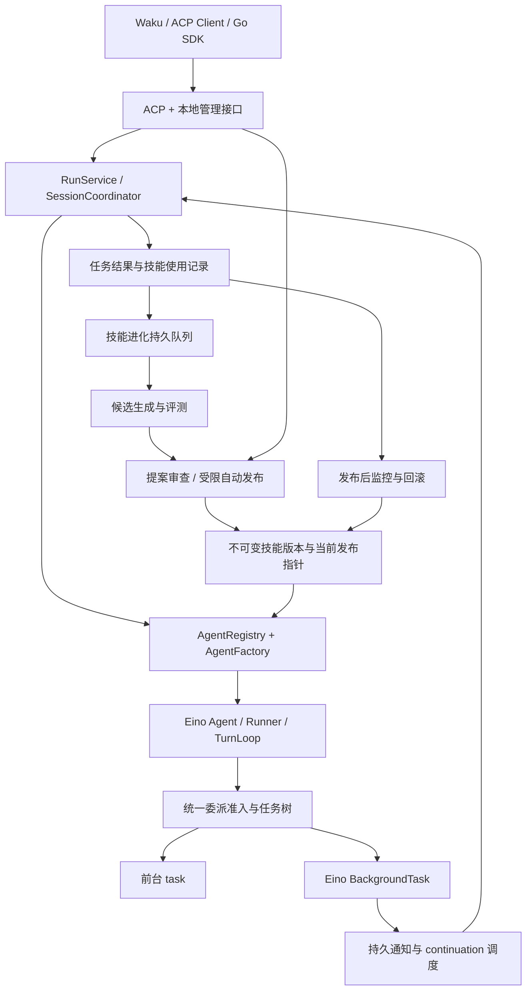

# Eino Harness 子代理、技能自进化与分支收敛方案

修订日期：2026-10-02。状态：本轮功能实施与开发手测包已完成，用户手测及正式发行验收待完成；阶段进展与剩余项见 [实施记录](eino-subagents-skill-evolution-status.md)。

工作分支：`codex/eino-harness-acp-refactor`。工作树：`C:\Users\ym200\.codex\worktrees\eino-harness-acp\deerflow-api`。

下文的新增字段、接口、状态投影和验收场景为本轮实施目标；以实施记录中的验证结果区分已完成部分与待完成部分，不能据配置类型或方案示例宣称能力已经可用。

**分支定位：本分支完整收敛为基于 Eino harness 的 DeerFlow 项目。此前 Python 运行时相关代码可以删除，并纳入本轮实施范围。最终源码、启动、测试、构建和分发均以 Eino Go harness 为唯一 DeerFlow 运行时；取消早期方案中 Python 双后端、自动探测和运行时回退的约定。** Waku 与 ACP Bridge 的 Rust 实现继续承担桌面及协议职责。

## 1. 目标与技术基线

在现有 Go harness 上补齐两条完整流程：

1. 用户配置不同角色的子代理，主代理可以在统一预算和并发限制内前台或后台委派；支持有限层级的再次委派、进度展示、取消、审批、恢复和结果自动回到父代理。
2. 从主代理和子代理的实际任务反馈中发现技能改进机会，生成候选、评测、审查或受限自动发布，再根据使用结果监控和回滚。

同时清理 Waku 的 DeerFlow 设置页，使所有可编辑设置和操作都对应当前 Go 后端的真实能力。删除已废弃设置入口；本轮新增能力在后端接通并验收后开放对应设置。

删除旧 Python 运行时及其专用服务、插件加载、启动和打包链路。需要迁移的行为先形成 Go 实现与回归依据；历史实现通过 Git 历史查阅，不在最终工作树或源码交付物中保留一套可运行的 Python DeerFlow。

该约束同样覆盖本轮新增的子代理和技能自进化全流程：候选生成、内容检查、行为评测、发布、观察期和回滚均由 Go 宿主实现。行为样例及预期结果使用宿主加载的数据文件和 Go 断言；不得为了评测、技能创作或数据迁移重新引入 Python runner。对应阶段的测试和最终无 Python 环境验收共同检查这条约束。

沿用 Go SDK、ACP stdio、本地 daemon IPC/MANAGE、Waku 桌面和 SQLite。运行包、技能管理工具、生成与验证流程均不依赖 Python；本轮不增加 HTTP 服务。已配置模型和工具的正常出站请求继续由现有 provider/工具适配器负责。

核心继续使用 `github.com/cloudwego/eino v0.10.0-alpha.35`。2026-10-02 再次通过 `go list -m -versions github.com/cloudwego/eino` 核验当前 Go 模块源，最新预发布版仍是 alpha.35；后续升级必须经过现有 checkpoint、HITL、工具回执和后台任务回归。模型扩展维持当前通过组合编译的固定版本，参考 eino-ext 和 eino-examples 的公共 API 用法，不统一浮动升级依赖。

### 现状与本轮增量

| 领域 | 已有基础 | 本轮补齐 |
| --- | --- | --- |
| 前台子代理 | Eino DeepAgent 原生 `task`、权限和预算继承 | 自定义角色、独立模型、配置生效、统一并发、有限嵌套 |
| 后台子代理 | `background_agent`、持久任务、查询/等待/取消、审批与恢复 | 多角色重建、子任务树、资源重建、自动结果投递 |
| 结果通知 | 持久 inbox 和显式 `ProcessBackgroundNotification` | 会话空闲时的持久自动调度 |
| 技能 | 安装/启停/删除、不可变版本、运行快照 | 候选、评测、审查发布、监控、回滚 |
| 桌面 | 子代理开关、角色配置表单、提案审查界面，以及部分未接通的旧配置 | 清理无效设置、按实际能力提供配置、任务树、真实提案后端和状态展示 |
| 仓库与交付 | Go 运行包可用，旧 Python 核心及依赖已从工作树删除，入口与构建已改为 Go/Rust | 完成 Linux 原生入口、干净环境和同源源码/桌面包验收 |

现有实现依据见 `go-harness/internal/engine/eino/prepared.go`、`background_tools.go`、`background_host.go`、`internal/runtime/background_store.go`、`continuations.go`、`internal/skills/`。迁移期间对照旧 Python 的 `deerflow/skills/evolution/`、`deerflow/acp/proposal_control.py` 和 `deerflow/config/subagents_config.py`，删除前记录基线提交及必要的脱敏协议/行为 fixtures；完成后从 Git 历史查阅这些旧文件。

## 2. 总体结构



Eino 承担模型运行、Agent 编排、原生中断/恢复和后台执行机制。Go harness 承担角色解析、权限与预算、任务所有权、技能发布、持久调度和产品协议。新增功能复用现有运行与存储设施。

## 3. 子代理设计

### 3.1 统一角色定义与配置解析

增加宿主拥有的不可变 `AgentSpec`，包含角色名称、描述、提示词、模型引用、生成参数、工具/技能选择、轮次、超时、可委派角色及版本摘要。用 `AgentRegistry` 管理定义，用 `AgentFactory` 构造 Eino Agent。

- 内置通用角色和自定义角色统一注册。已有内置名称建立迁移映射；未知名称报出具体配置路径。
- 同一个角色可用于前台 `task` 和后台 `background_agent`，两条路径调用同一 Factory。
- `task` 保留已有参数契约；`background_agent` 增加可选角色字段，缺省仍是通用角色。模型只能指定已登记的角色和任务描述。
- 接入 `subagents.agents`、`custom_agents`、`enabled`、`timeout_seconds`、`max_turns`、模型和采样参数，工具/技能白名单及拒绝列表。
- `null` 工具/技能列表表示继承可见集合，空列表表示不授予；角色选择与父运行可用集合取交集。角色提示词和技能内容不能扩大权限。
- 角色模型必须引用 `models` 中有效且允许使用的模型。`inherit` 绑定创建时的父模型。明确设置但 provider 不支持的 thinking/reasoning 参数在验证时拒绝。
- 新格式使用单一 `subagents.enabled`，显式 `--disable-subagents` 优先于 YAML；工具策略和会话开关仍可进一步收紧。宿主实际关闭后，会话设置不能重新开启。未迁移旧文件继续保留原双开关语义，转换规则见第 5 节。

前台优先使用 Eino `deep.Config.SubAgents` 和公开 middleware 接口装配。并发、版本、权限等宿主逻辑放在适配器中，不修改 Eino 模块缓存。若公共入口不能满足完整恢复契约，先用独立技术验证确定最小适配范围，再进入产品实现。

### 3.2 真正生效的并发、层级与预算

- `subagents.max_concurrent` 定义为同一根任务下，前后台及所有层级共享的活动子代理执行上限，范围 1–64，缺省为 2；旧 `local_acp.max_concurrent_subagents` 在显式迁移时保留原值并删除旧键。
- `background_workers` 是 daemon 后台执行资源上限，两者分别限制业务并发和宿主资源。前台 `task` 必须经过同一根任务准入，避免绕过上限。
- 增加有界排队和队列超时；超时返回可理解的委派失败，父代理可调整方案。
- 增加 `max_depth` 和每角色 `delegate_to`。默认深度 1；本轮交付可配置的多层委派，初始支持上限 3。宿主从已保存父子关系计算深度，拒绝循环角色链及越级访问。
- 所有层级使用原 `RootBudgetID`；同时限制总模型/工具调用、token、执行时间和子任务数量。恢复、改用角色和自动 continuation 均不能重置总预算。
- 子任务的角色超时与根任务剩余时间取较小值。排队、审批、等待后代分别记录，不混同模型运行时间。

**避免嵌套死锁。** 不能让父子代理持有全部 worker/并发槽后同步等待后代。等待子任务时，持久保存等待关系并释放活动执行槽；资源清理完成后才允许释放，待后代结果到达再重新准入。业务等待状态映射到 Eino 支持的暂停/恢复机制，不随意增加原生状态枚举。验收必须覆盖并发上限为 1 的三层任务。

根前台运行和其中的前台角色同样使用持久等待。恢复继续使用原 run/input、角色目录和根预算；执行状态以 `waitingTasks` 展示依赖，不生成工具审批。检查点同时含权限请求和任务等待时，权限可先处理，未就绪依赖继续挂起。任务已完成但结果仍需核对时不能唤醒父代理。前台等待的自动唤醒需验证当前连接所有权，并与会话输入、显式恢复及取消互斥；从终态通知创建新 run 的调度按 3.4 节另行处理。

SDK 通过显式、长生命周期的 `ServeSessionUpdates` 接收自动恢复输出与新审批，ACP 使用当前连接拥有的会话订阅。禁止复用已返回 prompt 的回调。只有纯任务等待就绪且会话空闲时自动恢复，不抢占已排队的用户输入；同一检查点最多自动尝试 3 次，退避和次数持久化。新审批没有处理器时保留待审批状态；普通取消同时覆盖空闲中的持久等待，断连与关闭订阅则保留可恢复检查点。

### 3.3 后台重建、隔离和恢复

扩展现有 `BackgroundSpec`/Binding，固定角色版本、解析后的模型路由、技能版本、有效工具策略、父任务、根会话、深度和授权来源。将当前固定 `deerflow-child-v1` 的重建逻辑改为版本化角色重建。

后台 child 已按解析后、不可变的角色/模型快照校验，支持与 parent 独立的模型。保留旧 spec 解码器和旧通用角色版本，使已有检查点仍能被识别；无法满足旧资源约束时暂停并报告原因。

后台子代理的再次委派使用宿主签发的任务身份和祖先关系校验，不借用旧的前台连接身份。用户仍从根会话管理整棵树，每一级子任务只操作自己的后代。

隔离针对会话历史和上下文；同一工作区仍可能共享文件。默认只传显式任务说明和授权的资料引用；独立工作目录为可选项。需要共享文件的任务显示工作目录和产物归属，不能宣称上下文隔离等于文件系统隔离。

MCP 分两种处理：宿主持有且可重建的服务按已保存配置引用重新连接；客户端持有的服务使用资源租约，客户端断开后进入资源等待，重新附着并验证代际与授权后恢复。凭据保持在宿主存储，不进入角色快照或模型输入。客户端没有资源重建能力时明确显示限制，不能悄悄删除工具继续执行。

2026-10-02 当前实现已覆盖客户端资源 lease、实际 schema/配置摘要、连接代际和显式资源版本授权，后台 claim 与 continuation 调用前重验。客户端断连会让活动借用者排空到安全检查点；不确定效果继续要求回执核对。新增独立宿主 `mcp.host_recipes` 注册表，默认空；每项绑定精确绝对工作区，宿主连接跨客户端 detach 保留，由 SDK Close 统一回收。只有明确 `restore_on_restart: true` 的配置可在重启时按不可变 recipe ID、配置/实际 schema 摘要重建并 CAS 更新独立资源授权，不改执行快照或重放工具；缺失/变更配方等待处理，任意旧客户端 MCP 不自动晋升为宿主资源。原始配方/凭据不进入模型、角色或桌面配置快照，编辑宿主 YAML 后重启生效。初版同一工作区不能混入 client MCP。Waku 已接资源等待/授权及任务树；产物读取按持久归因和根连接所有权提供，SHA256 分块验证并通过后台保存动作下载。根会话忙时保存动作返回 busy，不结束聊天。

### 3.4 自动结果投递、取消与失败

在现有 `ProcessBackgroundNotification` 前增加持久调度器，复用其幂等来源和预算绑定：

1. 接收并持久化可处理的终态通知；完成 outbox ACK。
2. 等待父会话空闲、没有待恢复执行，并验证当前所有者/资源。
3. 自动模式下调用现有 continuation 准入，创建唯一的新 run/input。
4. 同一通知最多绑定一个逻辑 continuation；重复消息返回原 execution。
5. 父代理获得结果后汇总、继续推理或发起下一次委派。

私有父角色续跑固定原角色身份、已提交的私有对话版本、模型、工具/技能及目录；不会将根会话历史作为角色输入。角色对话先按 attempt 暂存，与成功检查点或完成状态同事务提交。最终摘要以 `role_result` 通知交给直接祖先，逐层恢复各祖先自己的上下文；全部自动步骤共享原根任务续跑额度。完成摘要绑定其对话版本和摘要值；重启恢复丢弃未提交的前台暂存。经引擎确认且回执明确的普通角色失败提供失败摘要，存储错误及效果不确定仍进入核对流程。前台宿主和后台宿主分别验收，不能用前台已实现代替后台完成。

新用户输入优先；用户明确停止后保留结果，关闭该任务树的自动续跑资格。通知已读、模型投递和工具批准仍分别记录。增加每根任务自动续跑次数上限与退避，避免失败反复唤醒。

`auto_continue` 缺省关闭，`max_auto_continuations` 缺省为 10，设为 0 时不创建自动新 run。新任务保存有效策略；旧任务未保存该策略时只允许显式处理。根任务续跑计数与来源、run/input、预算准入同事务提交，重启和后续配置修改不能重置次数。`task_wait` 等托管工具已交付的结果单独持久记录，避免终态通知再次触发汇总；UI 已读状态不充当模型交付依据。

结果交付记录同时覆盖前台和后台角色：观察到终态结果时先暂存，随成功的检查点或完成状态一起提交，失败且未保存进度的尝试不记为已交付。通知先到或后到都得到一致状态；祖先查询后代结果不能代替原父角色接收。后台持久等待也必须核查后代的工具回执，存在尚待核对的外部效果时继续等待。

默认仅在会话有当前授权连接时自动推进。断连期间可脱离客户端资源的后台任务按已有策略运行并保存结果；重新连接后继续投递。无人连接不会自动批准新工具。恢复、配置冲突、预算耗尽和资源缺失在任务卡中显示具体原因。

父任务的“取消整棵树”和单个子任务取消分别提供入口。普通子任务失败返回结构化结果，父代理可重试或改计划；未知外部效果、存储损坏及回执冲突继续进入现有核对流程。不能通过换子代理重放效果不确定的工具。

## 4. 技能自进化设计

### 4.1 进化对象、入口和使用证据

增加 `internal/skills/evolution`，复用现有 Registry 的内容校验与不可变版本。

提供两类入口：模型通过 Go 原生 `skill_manage` 提交明确的改动提案；持久 collector 从任务结束事件、用户反馈和重复流程中发现候选。工具兼容旧 `create/patch/edit/delete/write_file/remove_file` 语义，仅操作候选区。

每个信号关联 session/run/task、技能 source/scope/name/version、实际读取技能的事件、结果证据与归因置信度。只列出技能元数据不算实际使用。子任务和根任务关联去重，防止同一次失败重复计入。

采集用户明确纠正、可归因的重复失败、重复成功的工具流程和明确缺失的技能。网络故障、配额耗尽、用户取消或拒绝权限单独分类，不能直接判定技能质量下降。保存脱敏摘要和必要事件引用，避免复制完整对话和工具凭据。

任务终态与进化 outbox 同事务保存，后台 worker 再处理。生成器或评测器失败不会令已完成会话报错；状态可查询并有界重试。进化后台使用独立、显式配置的维护预算和并发限额；父任务中的 `skill_manage` 调用仍计入父预算，后台费用可按来源追踪。

维护预算按 UTC 自然日汇总同一数据库所有技能源的模型调用与 Token，用量覆盖生成、安全审查、质量审查及行为评测调用。每次请求先持久扣除估算输入和输出上限，再依据完整有效的提供方用量结算；请求失败、取消、缺少用量或 worker 崩溃均保留保守扣额。重试不得清空预算、次数或首次领取时固定的作业截止时间；跨天回包仍结算到原请求所属日期。提供方 SDK 的自动重试关闭，由持久作业按独立额度决定是否重试。该限额统计调用和 Token，不宣称精确货币账单。

2026-10-02 持久证据进展：运行快照已接入成功技能加载和文本支持文件读取观察器，记录不可变版本、根任务、run/attempt/角色及文件摘要；目录元数据、管理接口读取和失败读取不计入。前后台终态通过业务状态表的 SQLite trigger 与待处理 outcome 同事务保存，取消和效果不确定单独保留，等待/待核对不冒充已完成。重复读取按 attempt/角色去重；宿主已接入持久 collector，进一步按根任务/来源/技能版本聚合，有界分页、租约、三次重试、版本 CAS 重试及 SDK/MANAGE 查询已实现。采集层不调用模型，信号明确标记 `unassessed`；独立维护预算和候选生成已接入 SDK（见 4.2），重复明确纠正的自动选择进展见下文，可信质量归因与行为评测仍待实施。证据边界见 `go-harness/internal/runtime/skill-evidence.md`。

2026-10-02 用户反馈进展：新增 Go 持久反馈服务、SDK 和认证 MANAGE 的 get/list/submit。操作者判断绑定已存在的 signal 与 1–16 个实际读取 ID，来源、技能版本和根任务由宿主派生；每个根任务/技能版本只有一个当前判断，修订和撤回保留有界历史，不累加为重复票数。新写入同时校验读取证据版本与反馈版本，先验证来源授权再处理原请求幂等，collector 更新或新判断不能使断线重试重复生效。摘要按字节限长并处理常见凭据/URL 模式，数据库仅保留清理后的文本及原始意图摘要；规则不保证识别任意秘密文本。网络/额度/权限/取消作为用户报告分类，`attribution` 仍为 `unassessed`，不直接发布或回滚。提交操作本身只记录反馈；单独启用的后台 worker 可选择重复明确纠正进入生成。可信故障分类和质量归因仍需继续实施。完整契约见 `go-harness/internal/skills/evolution/feedback.md`。

同日 Waku 反馈源码已接入信号/读取/历史分页、跨页选择读取、分类与摘要、当前反馈刷新、双版本提交和确认撤回。所有操作通过后台 MANAGE，渲染只读取缓存；更换目标、证据或服务撤销旧提交条件，保留文本草稿。原请求回放只展示操作回执，明确结束重试清理原请求身份。编译及 7 项新增纯状态测试、Waku 56 项/core 31 项相关回归通过；真实桌面交互及发行包仍待验收。

明确缺失技能的报告使用独立 `SkillMissingReport`，由操作者通过 SDK 或认证 MANAGE 提交；不放宽现有反馈必须引用实际读取的规则。报告固定标明 `origin=operator`、`kind=missing_skill`、`attribution=unassessed`，允许任务完全未读技能，也允许已读其他技能的任务报告缺少另一项能力。宿主从已有 run 和根预算关系派生根任务/会话，请求中的会话 ID 只用于匹配核验，不接受伪造的来源、技能版本或读取证据。

每个根任务维护一份可修订/撤回的当前缺失报告和有界历史，后代报告归到相同根任务；所有变更执行版本校验及稳定请求键幂等，重试返回原回执与最新版本。摘要复用反馈脱敏与长度限制，原始文本不落库；报告随根会话删除。SDK/MANAGE 分别提供提交、当前状态、分页和历史，管理权限沿用认证本地管理通道，支持已断开的真实前台会话。该报告不创建读取信号、不调用模型、不直接发布；以后选为生成依据时再验证目标技能源授权。

2026-10-02 缺失报告进展：上述持久服务、Go SDK 与认证 `skill.missing.submit/get/list/history` 已落地，并增加 `skill.missing.targets` 查询真实根任务，供 Waku 选择尚无报告、尚未读取技能的任务。归属由真实 run、根 run 和预算成员共同核验，后台私有会话不能冒充前台根会话；报告写入与根会话删除由同一数据库事务机制互斥。报告最多 1000 次修订，最后一格留给撤回。targets 按原始根 run 创建时间与根 ID 倒序进行实时分页，返回根 run 状态而非后代汇总状态，不暴露原始提示词；后台续跑不会把旧任务移到最新位置。并发、重启、丢响应重试、伪造归属、零读取和真实后台树删除已通过核心/集成验证。

同日 Waku 缺失报告表单已接入源码：从当前聊天的原生 Go 会话查询真实任务，支持无已有报告的任务选择、当前修订读取、提交/撤回及历史分页。会话/任务/服务变化撤销旧提交条件并保留草稿，回放只确认原操作、不覆盖当前状态；共享技能操作重试绑定原配置与数据目录，同目录服务重启允许核对。所有查询在后台执行，渲染只读缓存。缺失报告现可经独立开关路由到显式授权的非内置来源并创建新技能候选；真实桌面和发行包仍待验收。

2026-10-02 重复纠正自动选择进展：新增显式 `discovery.operator_corrections_enabled`，默认关闭，依赖已启用的 evolution、generation 和独立维护预算。同一来源/技能内容版本的当前 `correction` 必须来自不同根任务，引用真实读取且信号版本、反馈修订仍一致；根任务及其后代已终结并完成证据采集，取消和效果不确定记录不参与。当前安装 head 必须存在、启用且内容版本相同。旧 `discovery.enabled` 仅作迁移诊断，不会启用自动消费。

选择记录、生成作业、已消费根任务摘要、UTC 日选择额度和来源/技能冷却同事务保存；快照只保留引用和摘要，脱敏反馈在实际调用前读取。每个新付费阶段、候选提交、提案挂接及人工批准前重新核验，撤回、修订、任务删除或来源变化不能继续授权旧证据。已完成审查且证据有效的候选在关闭自动生成后仍可人工批准；已发布操作保留幂等回放。失败/取消不返还日选择额度或根任务计数。并发准入限制统计全部活动生成与未完成提案，同一活动作业和已挂接提案只计一次。

SDK/认证 MANAGE 提供只读 `skill.discovery.status/list`；自动作业显示 discovery ID 并沿用回执/审查流程。新增缺失报告和重复完成流程两个默认关闭的入口，必须指定 `new_skill_source_id`，保持工作区及来源授权。前者允许一个当前明确报告、零技能读取；后者要求跨独立根任务的成功回执序列，只保留工具名和参数形状。两者共用冷却、日/待审限制和维护预算，每个付费及提交阶段重验活证据。发现记录仍保留 `attribution=unassessed`，新建技能继续人工审查。

可信质量判断通过独立 `signal.quality` 提供。宿主未结束、效果不确定、取消、预算及类型化工具环境错误不参与质量票数；普通纠正和未知失败不被自动归为技能原因。操作者可选择明确的 `quality_failure`，绑定真实读取及当前修订；满足排除条件后才成为高置信失败。`helpful` 还要求全部根工作完成。已确认失败也可通过显式纠正入口按跨根阈值生成修复候选。P5 仅消费当前、高置信且与被观察发布窗口/版本匹配的质量证据。

### 4.2 候选生成与评测

生成器固定目标技能基础版本和相关证据，输出完整候选清单及 diff。增加 Go 原生技能模板、frontmatter 验证、引用检查和 diff 能力，提供不含 Python 脚本的 skill-creator 技能包。

评测按以下顺序进行：

| 层次 | 检查内容 | 失败处理 |
| --- | --- | --- |
| 确定性验证 | 路径、文件数量/大小、frontmatter、引用、工具存在性、Python 依赖、内容摘要 | 拒绝候选并给出可定位原因 |
| 内容与权限检查 | 指令越权、凭据内容、脚本及权限变化；复用静态扫描并加入配置的模型审查 | 检查不可用或结果无效时禁止发布 |
| 行为评测 | 在临时工作区和 fixture 工具中比较基础版本与候选；必要时用已授权隔离环境 | 记录样例、结果、耗时和成本 |
| 质量判断 | 使用独立评测调用判断任务适配、描述与触发范围，结合确定性评分 | 只作为辅助证据，不能单独批准自动发布 |

评测不直接重放真实外部写操作。生成器和评测器允许分别选模型；同模型时也使用隔离上下文。自动发布至少要求可重复的针对性样例通过、基础回归无退化、检查完整有效；缺少可验证样例的候选留给人工审查。评测报告记录模型、配置、样例集和评分规则版本。

2026-10-02 生成宿主进展：`internal/skillmaintenance` 的持久队列、三次尝试、租约/截止时间、按日预算与回执已接入 `internal/skills/evolution` 和 SDK 生命周期。显式 `Config.SkillGeneration` 固定来源授权及生成/审查身份；输入与入队、不可变候选与阶段进度、提案与作业关联分别同事务保存。重启接续已存候选及审查，完整 head、配置或来源改变会在新调用前被拒绝；失败/取消与未完成提案关闭具有事务约束。认证 MANAGE 提供生成入队、分页、详情、回执和版本校验取消，成功仅进入 `pending_review`，仍需明确批准发布。生成失败不改变用户会话状态；SDK 关闭会取消并等待正在进行的模型请求，保留未知用量的保守扣额。

2026-10-02 配置接入进展：YAML/save/launch/schema 与 Waku 原生表单已接通独立 `generation.enabled`、生成模型、输入/输出/超时限制和维护预算。生成缺省关闭，仅保存旧模型名不会启用；预算必须为正数，启动时将实际命名路由及已授权的候选来源交给 SDK。保存与启动共享校验，Waku 校验嵌套父/子字段能力并同步模型重命名。保存→启动→真实本地模型 fixture 已验证输入、输出、单次超时、作业截止时间和日额度实际生效；仍未完成真实桌面交互验收。

2026-10-02 Waku 操作接入进展：生成能力查询、目标版本检查、显式提交、作业分页/详情、版本校验取消和用量回执分页已接入源码。SDK/认证 MANAGE 新增只读 status/prepare，返回当前宿主实际来源授权及完整 head，支持尚不存在的技能并校验内置覆盖基础。草稿编辑使旧检查失效，传输失败保留原请求键，服务变化撤销缓存操作状态；生成草稿与配置分离，保存/应用未完成时不能提交。成功作业转到既有提案审核，关闭生成后仍可查看授权来源历史；真实桌面交互及发行包仍待验收。

collector 仍只采集元数据；显式生成使用操作者理由和固定基础版本，自动选择入口追加已核验的重复纠正证据。两者复用生成、安全审查、质量审查与独立维护预算，成功仅进入 `pending_review`。未配置适用样例的行为状态为 `not_run`，已配置时走下述独立评测。其他发现入口、可信质量归因、观察期和自动回滚继续属于必做范围。内部契约见 `go-harness/internal/skillmaintenance/README.md` 和 `go-harness/internal/skills/evolution/discovery.md`，配置及协议见 `go-harness/internal/acp/skill-evolution.md`。

2026-10-02 行为评测源码进展：新增默认关闭的 `skill_evolution.behavior`，由宿主一次性加载独立 JSON suite。每个样例、重复次数和基础/候选版本使用独立临时工作区及模型上下文，Eino 调用受限文件工具或确定性模拟工具，Go 依据实际输出、文件和工具调用次数执行断言。预期答案不进入模型输入；不执行 Python、Shell、OpenCLI、MCP 或技能脚本。新建技能跑真实空基础版本，删除技能跑真实空候选版本；不会虚构不存在的版本已被测试。

生成候选复用原维护作业；手工候选与独立行为作业原子入队，状态为 `validating`，拒绝时同时取消作业。内容审查和逐版本结果持久化，重启复用已完成部分；新调用和阶段提交验证来源、完整 head、覆盖基础、评测器、suite、证据及领取权限。宿主从持久结果组成并校验报告，内容审查器不能伪造行为结论。已配置评测未完成或失败时阻止批准，不能回退成未运行后继续发布。无适用 suite 明确标记 `not_run`，进入人工审查。报告中的已完成样例用量与包含失败尝试的完整维护回执分别可查。

SDK/认证 MANAGE 新增 `proposal.behavior` 和 `proposal.behavior.receipts`；Waku 源码接通六项设置、结构化对照、逐样例详情、回执分页和验证中拒绝入口，渲染只读取缓存。真实 Eino 本地 provider fixture、配置链路及 Waku 编译/纯状态检查已通过，最终核心回归结果见实施记录。该进展只覆盖受限样例评测，仍不启用自动发布、观察期和自动回滚。完整契约及无 Python 样例见 [行为评测说明](../go-harness/internal/skills/evolution/behavior.md)。

### 4.3 提案状态与发布事务

兼容桌面已有状态：`generating → validating → pending_review → publishing → published`；同时保留 `rejected/failed/stale`。生成内部的排队、评测进度和重试通过阶段字段表示。观察期、回滚和归档属于独立发布/管理记录。

提案至少保存目标作用域、基础版本、候选摘要、diff、信号来源、评测报告、状态版本、审查记录和预算使用。所有状态修改使用版本 CAS；重复提交和重复批准保持幂等。

扩展 Registry 的事务 API，以已验证候选创建不可变版本，并在同一 SQLite 事务内完成：

1. 检查 proposal 状态、期望基础版本和当前发布指针。
2. 保存/复用候选内容版本，更新安装发布指针及启用状态。
3. 保存发布序号、审查依据、观察期及审计事件。

发布版本和提案必须绑定同一 scope/source/name，禁止跨工作区批准。基础版本已变时标记 stale，重新生成或评测，不覆盖其他已发布修改。创建新技能时以“原目标不存在”为条件；删除使用撤销当前指针及墓碑，保留历史。

**运行中技能保持原版本。** 已创建的运行、后台任务和恢复检查点继续使用固定快照，新运行读取新版本。必要的即时撤销沿用宿主策略拒绝恢复，与普通版本回滚分开处理。

### 4.4 发布后不会被旧文件覆盖

SQLite 内的发布指针作为托管技能的权威状态。为每个安装源记录上次导入摘要和管理模式：

- 外部导入源仍可显式重新导入；启动发现源变化时报告差异，不能覆盖已有进化发布。
- 进化生成的技能放入显式注册的托管源；磁盘目录为可重建导出视图。导出失败记录待同步状态，不改变已成功的发布结果。
- 内置只读技能的修改先创建作用域明确的托管覆盖版本，经过审查后启用；界面显示覆盖关系。
- daemon 重启时恢复发布指针，不重新用旧源码目录覆盖。回滚后的墓碑和覆盖关系也必须保留。

内置覆盖层沿用同一 source/name/scope 的不可变版本空间，单独保存原始导入版本及覆盖关系；内置属性属于宿主策略，不改变已有 source identity。新增 `allow_builtin_overlays`，默认关闭，显式开启后才向模型授予既有内置技能的候选提交权限。旧提案审查后若内置策略发生变化，要求重新提交审查，不自动改写原审查依据。源变化报告记录最后检查时间、状态以及有界文件路径/摘要差异，包含已删除的托管技能；报告不会发布或重新导入源文件。

托管源通过显式 source ID、root 和 scope 注册，运行内容只来自 SQLite，不能通过启动导入或磁盘旧文件重建发布状态。发布、启停、删除与导出队列同事务保存。导出 worker 在事务外构建文件视图，只有版本前置条件仍匹配时才将完成目录登记为 synced；不存在另一个磁盘 current 指针。文件失败最多自动重试三次，耗尽后等待显式重试，重启保留次数。成功视图重启后重新校验；缺失或被编辑时从数据库另建视图，不反向导入或覆盖旧视图中的编辑。Waku 显示发布状态和导出状态，并提供明确的重试入口。

增量建表保存 signals/jobs/proposals/publications/evaluations/probations 与必要 outbox；复用 `df_skill_*` 内容表，避免另建一份互相竞争的技能版本库。版本清理保留活动发布、待审基础版本、回滚目标以及检查点/后台任务引用。

### 4.5 发布模式和自动回滚

交付两种模式，配置默认保留 `review`：

- `review`：自动发现、生成和评测，用户在 Waku 查看 diff/证据后批准或拒绝；支持新建、更新、支持文件变更和删除。
- `auto_patch`：仅对已有、受管理的技能进行小范围 `SKILL.md` 修改；沿用旧版自动发布限制，例如最多 40 行。新建、删除、支持文件及脚本变更转入人工审查。所有候选仍经过同样的校验和评测。

Python runtime、Python 脚本或要求 Python 运行的技能不能进入此交付包。其他可执行支持文件只有在宿主允许并完成隔离验证后才能人工发布；自动模式不新增可执行代码。

发布后默认观察 3 次具有有效结果证据的使用。连续 2 次可归因失败触发回滚；阈值可配置。回滚通过新发布记录切回上一有效版本，保留全部历史。只有当前指针仍指向被观察版本时才执行 CAS 回滚；旧运行的迟到结果不能回滚更新的发布。新建技能没有上一有效版本时回退为禁用/移除覆盖指针。低置信度或缺少证据时继续观察并呈现待审状态。

2026-10-02 已实现 `auto_patch` 原生 worker、事务发布/观察记录及 SDK/MANAGE/Waku 状态入口。自动范围进一步要求基础版本已进入发布管理、目标已启用，且宿主针对性/回归样例通过；首次导入技能需要先人工采用为托管版本。默认观察上限为 72 小时，最少 3 次有效根任务判断；可信成功打断连续失败，忽略的环境结果不改变连续计数。到期证据不足明确显示 `insufficient_evidence`，不会冒充通过。观察记录、已消费判断修订和回滚历史跨重启保留，当前指针改变标记 `superseded`。新建技能不进入本自动发布入口，因此其自动观察回退仍不开放。

进化可以修改技能说明和允许的支持文件；修改 harness 代码、安装新依赖和调整宿主授权继续走普通开发/配置流程。

## 5. 配置契约

下面是当前原生配置示例；`primary` 必须对应 `models` 中已配置名称。模型、令牌、预算等示例值需按实际部署设置。启用 `auto_patch` 还须启用 generation、behavior 并指定可用宿主 suite。

```yaml
config_version: eino-harness-v1

subagents:
  enabled: true
  max_concurrent: 2
  timeout_seconds: 900
  max_turns: 50
  max_depth: 2                 # 新增；兼容缺省值为 1
  background_workers: 4        # 新增 YAML 映射；现有 CLI 已支持
  max_tasks_per_root: 20       # 新增
  auto_continue: true          # 新增；等待会话空闲且资源可用
  max_auto_continuations: 10   # 新增
  agents:
    general-purpose:
      model: inherit
      delegate_to: [researcher]  # 新增，仍受深度和策略约束
  custom_agents:
    researcher:
      description: 搜集资料并给出可验证来源
      system_prompt: 完成指定研究任务，返回结论、证据与未解决的问题。
      model: primary
      tools: [web_search, web_fetch, read_file, glob, grep]
      skills: null
      max_turns: 20
      timeout_seconds: 300
      delegate_to: []

skill_evolution:
  enabled: true
  mode: review
  allow_builtin_overlays: false
  generation_model_name: primary
  moderation_model_name: primary
  evaluation_model_name: primary
  security_fail_closed: true
  generation:                # 已实现：后台生成；默认关闭
    enabled: false
    timeout_seconds: 60
    max_input_bytes: 131072
    max_output_tokens: 8192
  discovery:                 # 三类入口独立启用，默认均关闭
    operator_corrections_enabled: false # 开启前须启用 evolution 和 generation
    missing_reports_enabled: false
    successful_workflows_enabled: false
    new_skill_source_id: ""   # 后两项开启时必填，已授权非内置来源
    repeat_threshold: 2
    repeat_window_days: 30
    cooldown_hours: 24
    max_daily_proposals: 5
    max_pending_proposals: 20
  behavior:                  # 已接入：宿主样例的基础/候选对照；默认关闭
    enabled: false           # 开启前须启用 evolution 和 generation
    suite_path: ""           # 独立宿主 JSON；相对 config.yaml
    timeout_seconds: 60
    max_steps: 6
    max_input_bytes: 131072
    max_output_tokens: 1024
  auto_patch:
    max_changed_lines: 40
    max_daily_publications: 2
    observation_hours: 72
    min_observations: 3
    rollback_failure_threshold: 2 # 连续高置信质量失败
  budget:                     # 已实现；启用生成时必须显式配置正数额度
    max_daily_model_calls: 30
    max_daily_tokens: 100000
    max_job_seconds: 300
    workers: 1
```

显式 CLI 参数优先于 YAML。建立规范化的 Go 配置结构；保存、validate 和 daemon 启动使用同一套校验。对仍适用于 Go 的既有字段保持数据兼容；Python 类路径及废弃运行时参数通过显式 Go 导入/迁移转换，不能继续作为运行时动态加载入口。未知受支持命名空间字段、无效模型引用、互相冲突的限制应报告具体路径。候选及发布元数据统一保存到 SQLite；文件导出使用 `skills.export_root`，托管来源使用 `skills.managed_sources` 显式配置 id/root/scope/workspace。旧 `skill_evolution.storage_path` 仅作为历史导入来源，不作为第二套元数据数据库；配置转换与历史文件导入分别执行。

迁移保持用户原有启用状态；已有配置 `skill_evolution.enabled: false` 不会因升级被开启。角色/模型策略变化作用于新运行，恢复旧运行时验证已固定版本并重新应用即时撤销约束。

配置增量（2026-10-02）：人工候选、内容审查、内置覆盖、生成、发现、行为评测及受限自动发布均接入共享 schema 和 Waku 原生表单。候选文件/大小边界由宿主固定校验；新建、支持文件、脚本和删除不能通过 auto_patch 配置放开。旧未消费字段仅提供路径诊断，经绑定当前 revision 的明确转换后删除；转换保持启用状态，强制 review 与安全审查通过。托管来源与导出路径已支持 YAML 和原生编辑器，保存/启动共用来源检查；表单包含导入/导出目录、全局选择、来源增删和 id/root/scope/workspace 字段，保留相对路径和 null 继承。原设置快照的文件技能列表和 extensions 启停写入已移除。旧 Agent 草稿转换及进化历史只读归档已接入，真实桌面链路仍需手测。

子代理配置采用显式格式边界。缺少 `config_version` 或已识别旧数字版本的文件保留旧行为：ACP 开关缺省关闭、角色总开关缺省开启，角色总开关关闭时 CLI 不能重新开启。迁移预览将两个开关按 AND 合并为单一 `subagents.enabled`，并发数保留原值或默认 2；无显式 CLI 覆盖时启用状态不变。新格式 `eino-harness-v1` 按“显式 CLI 优先于 YAML”解释，包括 `--disable-subagents=false`；这项与旧角色硬限制的差异必须在确认迁移前展示。确认绑定读取时的配置 revision，文件变化后重新审阅；保存先备份原文件、写入版本标识，再删除两个旧 ACP 字段。新格式拒绝混入旧字段，未迁移文件拒绝混入新的并发键。该步骤只完成子代理控制迁移，其他历史字段、类路径和数据导入继续按 P0/P6/P7 处理。

## 6. ACP、本地管理与 Waku

### 协议

| 接口 | 实施内容 |
| --- | --- |
| 标准 ACP | 保持会话、config options、工具事件和权限请求；新增能力按实际支持声明 |
| `_deerflow/tasks/*` | 扩展角色、父子关系、深度、排队/等待原因、版本和用量；允许根会话查询树与级联取消 |
| `_deerflow/notifications/*` | 保留显式 process，增加自动处理状态；自动/手动调用共用幂等准入 |
| 本地 MANAGE `proposal.*` | 实现现有 list/get/approve/reject/history/rollback，保持 `{ok,data}` 契约 |
| 本地 MANAGE `skill.*` | 技能目录分页/详情、带完整源身份及 head 的持久启停、定向源报告刷新和带导出状态 token 的重试；操作审计、幂等、过期页面冲突检查 |
| 本地 MANAGE 进化管理 | 增加状态、信号查询、重试/取消、归档/恢复和反馈操作；列表分页、有界历史 |
| 可选 ACP 技能管理扩展 | 以 `_deerflow/skills/*` 协商暴露同一应用服务，按会话工作区授权；全局发布保持宿主管理权限 |

ACP 扩展与本地 MANAGE 是不同协议入口，内部复用同一服务。模型侧 `skill_manage` 只有提出改动和查询自己提案的权限，不具有审查批准权限。

技能列表包含禁用项与删除墓碑，返回内置/托管源属性、覆盖来源、最后源变化报告及当前导出状态。目录翻页绑定配置源、查询条件和发布 revision，发布状态变化后要求从第一页刷新；导出 worker 的进度变化不使发布目录游标失效。启停必须保留用户决定，不能在启动时被导入配置覆盖；重发同一操作返回原处理结果及当前状态，不重复执行。导出重试同时检查发布 head 和导出状态 token，避免旧页面重置新一轮同步。

旧桌面回滚使用整数 revision，新技能内容版本是 SHA-256。增加发布序号与内容版本映射，保留旧显示字段；批准及回滚同时支持期望当前版本，旧调用缺失时由服务端取得并 CAS，冲突要求刷新。UI 提交当前观察版本以防用户基于过期界面操作。

### 桌面

- 子代理设置增加有效模型、工具、技能、层级、并发和自动续跑；展示实际解析值及验证错误。
- 任务区域展示父子树、前后台模式、角色、状态、模型、用量、结果/产物，以及取消、审批和恢复入口。
- 技能区域展示进化开关/模式、信号、候选 diff、评测报告、批准/拒绝、发布历史、观察期和回滚。
- 配置变更明确提示对新任务生效；旧任务保留自己的角色/技能版本。
- 磁盘访问、MANAGE 请求、diff 加载和队列查询放在后台，UI 只读取缓存投影；子进程保持隐藏终端。

### Waku DeerFlow 设置页无效设置清理

#### 清理原则与字段清单

逐项核对“页面字段 → 保存键 → Go 配置解析/客户端消费 → 实际运行行为”，形成字段清单。清单记录 UI 路径、配置路径、消费方、有效枚举、作用范围、应用方式、处理决定及验证依据。范围覆盖概览、模型、智能体、记忆、技能、工具、运行和高级设置，以及这些页面中的操作按钮。

字段能保存到 YAML、通过表单校验或在 snapshot 中返回，均不能单独证明该设置有效。由 Waku/Bridge 消费的客户端设置需要核查客户端链路，不能仅因 daemon 配置结构没有该字段而删除。

| 设置或入口 | 当前依据与问题 | 本轮处理 |
| --- | --- | --- |
| 默认智能体 `runtime.agent_name`，旧主智能体目录、`SOUL.md` 编辑入口 | 当前 Go 设置文案明确表示只运行默认智能体；保存目录不代表运行时加载 | 从 Go 页面移除旧主智能体配置，保留实际有效的附加指令；智能体页改为本轮 AgentRegistry 支持的子代理角色，旧主角色仅提供显式导入草稿 |
| `goal_auto_continue`、`goal_max_continuations`、`goal_max_no_progress_continuations` | Go 保存/启动拒绝启用旧目标自动续跑，页面仍提供编辑 | 删除旧入口；P2 提供独立命名的“后台结果自动处理”和次数限制，禁止直接把旧目标续跑值映射为新行为 |
| `memory.storage_class`、Python manager/class 选择 | 旧 Python 类名和实现选择没有 Go 运行语义 | 从普通及高级页面删除；必要的实现信息作为只读状态展示 |
| 旧 `memory.storage_path`、`retrieval_index_path` 及概览中的 JSON/独立索引路径 | 设置页仍构造旧存储路径，Go 运行使用其持久存储 | 移除未被 Go 消费的路径编辑，概览展示实际 Go 数据库/数据目录；旧数据路径仅进入显式导入流程 |
| 记忆数量、阈值、去重、防抖、模型、注入 token 等高级参数 | 当前桌面可保存多项参数，启动适配仅映射部分记忆开关与模式 | 逐项建立消费证据；无有效映射的编辑入口移除，保留已接通的记忆开关、模式、注入、检索及有效作用域 |
| 全局记忆 `memory_scope: global` | 当前 Go 不支持，页面仍包含此选项 | 从 Go 可选范围中移除，只提供实际支持的 workspace/session；旧值显示迁移说明，不能静默改成其他作用域 |
| 子代理自定义角色、模型、并发、超时等 | 当前部分字段仅保存，本方案 P1/P2 接入 | 实现前不提供可用编辑入口；后端接通后保留受校验的表单，删除重复的整段 JSON 编辑入口 |
| `skill_evolution` 及提案审查按钮 | 当前仅保留配置和界面，运行服务未实现 | 按 P3/P4/P5 的实际能力逐步开放审查、发现和自动发布；缺少服务的版本不提供相应开关或操作 |
| 默认 thinking/plan、模型 thinking/reasoning 标识、模型高级参数、`tool_groups` 和沙箱高级字段 | 需要核对 Waku、Bridge、provider、工具和启动配置的实际消费，不能只按名称判断 | P0 明确每项消费者；有真实用途的保留并约束 schema，没有消费者的移除；有效的工具分组展示不冒充权限控制 |
| 模型连接信息、视觉支持、工具审批、OpenCLI 配置、工具允许/拒绝列表、MCP、会话清理和已接通超时 | 当前已有 Go 路径或客户端消费路径 | 保留并按真实能力验证；审批 `off/dangerous/all` 当前均有 Go 实现，不依据过期迁移文档删减 |

本表是初始清理清单；P0 必须覆盖页面全部字段，并将尚待核查项落成明确的保留/移除/替代决定。纯 Go 包不保留 Python 类路径、后端切换和只服务旧 Python 启动流程的编辑入口。

2026-10-02 已按当前 `fields_for`、配置 snapshot/save 和 daemon 消费路径补充 [Waku 设置字段审计](eino-waku-settings-audit.md)，逐组列出保留、移除、替换决定及运行依据。该清单属于实施准备；表单修改、能力 schema 和逐项生效验收继续作为 P0/P7 交付要求。

#### 后端能力与设置表单同步

扩展 Go 配置 snapshot/validate 协议，返回版本化的字段能力描述，包括 `schema_version`、后端版本、支持字段、可选值、字段依赖、可编辑性和应用范围。有效值及来源由运行中 daemon 状态提供；CLI 覆盖的值标明来源，不能把 YAML 草稿当成当前运行值。

Waku 依据所选安装包的配置工具能力和已连接 daemon 能力生成字段及操作。只显示支持的枚举值；没有有效字段的旧分组从导航和高级设置中移除。设置已支持但因当前条件不可用时可以禁用并说明原因，例如父功能开关关闭；永久废弃的字段从编辑页删除。

daemon 未启动时，可以根据同一安装包的 schema 编辑已知配置，显示“未运行、尚未应用”；版本不匹配或能力未知时只提供可确认的字段，禁止回退到全部旧表单。已有草稿不因能力刷新而丢失，失效草稿项列入迁移摘要。

保存校验与 runtime 共用规范化配置和能力定义。高级 JSON 仅允许已登记的 provider/工具扩展字段，并验证当前适配器确实支持；不能通过高级页面重新写入被清理的无效设置。

工具页面采用 Go 原生参数表单，按工具名称只显示实际消费的字段。`tool_groups` 不作为权限入口，授权使用工具允许/拒绝列表及宿主开关。移除文件/命令工具的参数条目不等于禁用该工具。API key 与含凭据代理地址按原工具身份保留，并提供明确清除操作；新工具配置不继承旧工具隐藏凭据。OpenCLI 站点的 `null` 保持内置默认、`[]` 不授予适配器访问，保存和迁移不得混同。沙箱快照使用 `provider` 原生字段，移除 Python `use` 和旧高级参数编辑器；未知原始数据仅保留为显式迁移输入并显示诊断。上述字段的保存、启动和真实工具消费分别验证。

实施进度说明（2026-10-02）：字段契约已升级为 `deerflow-settings-v2`，覆盖 runtime/memory/models/default_model/subagents，贯通配置快照、Go 校验、daemon 声明及 Waku 字段交集。子代理全局项及逐角色表单已接线，覆盖内置/自定义选择、角色增删/重命名、内置覆盖重置、模型/生成参数、工具/技能与委派关系。嵌套字段 schema 校验与启动器的严格角色解码、provider 参数校验共同生效；重命名在草稿中统一更新委派引用，选择内置角色不生成覆盖，null/空数组/false/0 语义分别保留。单一开关/并发键及显式旧配置迁移已接通；运行 daemon 另行报告子代理实际开关、并发、CLI/配置来源与工具策略限制，界面只读展示并区分草稿。实际桌面交互验收仍待完成。其余页面、其他字段的命令行覆盖来源和实际生效值继续按本节目标实施；不能用已接通部分代表设置清理全部完成。

#### 配置迁移与应用反馈

清理范围同时覆盖 UI 字段定义、默认值、snapshot 输出、保存逻辑、生成模板、示例文档和相关文案，避免下一次保存又把旧字段写回来。

- 第一次迁移建立受保护的原配置备份，展示删除、替代和需处理项；备份不进入普通日志或分发包。
- 已知废弃键在显式迁移保存时从活动配置删除；被 UI 隐藏的原数据不会因一次无关设置保存被批量删除。
- 未识别但可能属于外部扩展的键保持原值并列出诊断，在完成消费核查前不自动删除，也不作为可编辑有效参数展示。
- 有对应 Go 字段且语义完全一致的项目做版本化映射；无等价项仅保留备份。旧主角色导入子代理时显示模型/工具/权限差异，等待用户保存草稿后生效。
- 保持现有配置 revision 冲突检查和密钥脱敏/还原。清理与重新保存不能清空 API key、OpenCLI 路径、代理、MCP 环境变量等有效配置。
- 设置页区分“草稿”“已保存待应用”“已应用”和“应用失败”。后端确认加载到目标 revision 后才显示已应用；需要新会话或重启时明确提示，活动任务继续使用固定版本。

本轮不以“暂不生效”的常驻提示替代清理。完成后的页面只保留可用设置、必要的条件说明和迁移诊断。

## 7. 文件与存储改动范围

删除/替换清单见 [Python 清理清单](eino-python-removal-inventory.json)，固定本轮基线提交及文件 blob，随源码一同纳入版本控制。经 WSL、根入口、旧界面、集成和技能引用补充，当前共 584 个不重复路径：553 项已删除并验证，25 项已替换并验证，6 项完成替换与语法检查，待处理清单项为 0。删除依据为工作树中的实际文件状态；改动尚未提交。清单完成不等于 P6/P7 全部通过，CI 远程执行、原生 Linux 生命周期、无 Python 干净环境、源码 ZIP 和 Waku Release 仍须分别验收。

| 位置 | 主要工作 |
| --- | --- |
| `go-harness/harness/`、根包 Config/SDK | 角色、任务树、进化配置、提案和发布类型及 SDK 方法 |
| 新 `internal/agents/` | AgentSpec 解析、版本库、Factory、角色选择 |
| `internal/engine/eino/` | 前后台角色装配、委派准入、预算/中断/恢复接线 |
| `internal/runtime/`、`internal/background/` | 子任务树、共享并发、等待与恢复、通知调度及资源租约 |
| `background_host.go`、`background_tools.go` | 多角色后台契约和宿主子任务身份 |
| `internal/skills/`、新 `internal/skills/evolution/` | 候选、评测、发布事务、信号 worker、观察期、回滚 |
| `internal/storage/sqlite/` | 版本化增量迁移、索引、CAS、幂等记录和保留引用 |
| `internal/launch/`、`internal/desktopconfig/` | 统一配置映射、字段能力 schema、校验、旧键迁移、有效值/应用 revision 查询，清理旧默认值与保存回写 |
| `internal/acp/agent/`、`management.go` | 任务树和技能管理协议、分页及授权 |
| `desktop-app/src/app/` 及 ACP adapter | 任务视图、提案审查、能力驱动的设置表单/导航、无效设置清理、配置应用状态和通知操作 |
| `scripts/`、`docs/` | 无 Python 的集成 smoke、打包检查和配置/协议文档，移除旧启动/回退说明 |
| `deerflow/`、旧 `app/`、Python 依赖与测试目录 | 提取必要回归依据后删除旧 Python 运行时、服务、插件和专用测试 |
| `bridge/`、Waku 启动链路、根目录脚本及 `.github/workflows/` | 清除 Python 探测/回退、依赖安装和发布作业，统一 Go 运行时入口 |

数据库改动先备份再做事务迁移。已有 Go 角色/快照解码器保留；数据库迁移失败保持可诊断状态。旧 Python 进化目录通过显式 Go 导入器迁移为历史/待审记录，保留原始来源，导入过程不发布、不重新运行候选。Python LangGraph 执行快照不转换为 Go 执行快照。

### Python 运行时代码删除与项目收敛

#### 最终项目入口

本分支的开发、运行、测试、构建和发布均以 Eino Go harness 为唯一 DeerFlow 后端。删除旧代码是 P6 的必交付项；P7 同时验收源码与桌面产物。

| 职责 | 最终保留的实现与入口 |
| --- | --- |
| Agent 执行及应用能力 | `go-harness/`：Eino、Go SDK、工具、子代理、记忆、技能与进化服务 |
| ACP stdio 与常驻服务 | `cmd/deerflow-acp-go`、`cmd/deerflow-acpd-go`；保留现有协议和已发布 Go 数据语义 |
| 桌面配置 | `cmd/deerflow-config-go` 与统一 Go 配置结构；模板和保存结果不再生成 Python `use` 类路径 |
| 桌面与协议适配 | `desktop-app/` 的 Waku 和 `bridge/` 的 Rust 实现；启动目标固定到 Go 可执行程序 |
| 构建与分发 | Go/Rust 构建、原生检查工具和 PowerShell/Shell 编排；支持的 WSL 路径随包提供相应 Go Linux 辅助程序 |

保留现有 Go 程序名和数据目录的兼容性；是否简化名称不作为本轮删除前提。外部 OpenCLI/MCP 仍按显式配置接入，项目内置工具、默认配置及验收链路不得依赖 Python。源码扫描必须检查子进程参数及嵌入脚本，覆盖 `.go`、Rust、Shell、PowerShell、技能和 CI 文件。

#### 删除/替换范围

| 范围 | 具体处理 |
| --- | --- |
| Python 核心 | 删除 `deerflow/` 中旧 Agent/LangGraph harness、ACP daemon、工具、记忆、技能进化、配置和 Python 插件加载实现；必要行为由 Go 对应实现接替 |
| 旧服务及专用界面 | 删除 `app/` 旧 Python HTTP 服务；核对 `admin-ui/` 与旧服务依赖，删除仅服务该后端的界面和资源。共有静态资源先转移到实际使用方 |
| Python 依赖声明 | 删除根 `pyproject.toml`、`uv.lock` 及旧运行时专用依赖/打包元数据；清理 Python/uv/pip/虚拟环境安装要求 |
| 启动与服务脚本 | 核对根目录 `start.*`、`stop.*`、`daemon.sh`、`acp-daemon.ps1`、`acp-service.ps1` 等，删除 Python 专用脚本，仍承担受支持入口的脚本改为启动 Go daemon |
| Rust Bridge | 保留 DFACP/1、MANAGE 和 ACP v1/v2 必需协议逻辑；删除 `--python` 的后端选择能力、解释器环境变量处理、`python_daemon`、内嵌 Python/.venv/PATH 探测及回退。旧 `--python` 仅返回拒绝与迁移提示；Go daemon 缺失时报告准确错误 |
| Waku 及旧桌面 | Waku 固定使用 Go daemon/config 工具，删除 Python 后端选择及旧 config-tool 调用。核对 `desktop/` 旧桌面，删除仅用于旧产品的实现，先迁移仍被 Waku/打包使用的图标等资源 |
| Go 中的旧命名与加载适配 | 将实际使用中的 `internal/launch/python_config.go`、`PythonConfig`、`ApplyPythonConfig` 及测试重命名/收敛为原生 Go 配置加载；完整保留当前有效的模型、工具、权限、代理、MCP、记忆及技能映射。旧类名转换集中到独立导入工具 |
| Go 内嵌 Python 与 WSL 沙箱 | 替换 `go-harness/internal/sandbox/providers.go` 中的 `python3` 探测/路径解析/命令启动、`supervisor.go` 中的 Python 监督脚本和 `providers_test.go` 中的 Python 检查；以 Go Linux 辅助程序承担进程监督，保留现有沙箱行为 |
| Python 测试及开发脚本 | 必要测试提炼为脱敏 fixtures 与 Go/Rust 测试；替换 `scripts/test-deerflow-desktop-smoke.py` 等仍在使用的检查脚本后删除。弃用的 benchmark、demo 和旧测试直接移除 |
| 构建与 CI | 删除旧 Python 便携包/桌面包构建和 PyPI 发布流程；修改现有 CI/Release workflow，使 checkout、测试、构建、打包和 smoke 不安装 Python/uv/pip。统一默认构建入口到 Go harness + Rust Waku/Bridge |
| 技能与其他集成 | 清点 `skills/`、`examples/`、`integrations/`、`packages/` 中项目自有 Python 运行时代码。交付能力所必需部分先改为 Go/无 Python 实现；仅服务旧运行时的集成和示例删除。删除后同步修正技能引用和能力清单 |
| 文档与产物 | 更新 README、便携说明、架构/配置文档和发布清单；取消双后端与 Python 回退要求。二进制包和源码包均不包含旧 Python 运行时文件或依赖清单 |

按明确的受版本控制文件清单实施删除，避免仅按目录名、扩展名或关键词批量清理。用户工作区、`data/`、现有 `user-data/`、配置备份、技能个人修改及历史分发包不属于本轮源码删除对象。通用工具仍可按用户授权处理任意语言的用户项目；仓库收敛不会额外禁止用户工作区中的 Python 文件。

2026-10-02 启动链路进展：Bridge 的 Python 构造器、解释器环境变量选择、`.venv`/内嵌运行时/PATH 回退已删除；仅通过显式文件路径或同目录 Go daemon 启动，缺失时直接报错，旧 `--python` 返回迁移提示。根目录启动/停止脚本已改为 Go ACP 生命周期入口，Windows 原生 Bridge 和 PowerShell 链路已通过真实 Go daemon 验证；Linux 脚本已通过语法检查，原生 Linux 生命周期仍待 CI/环境验收。当时补入 8 个根入口，删除/替换基线清单增至 545 项；后续清理结果见下文，最新总数见本节开头。

2026-10-02 独立旧入口清理：实际删除 `.github/workflows/publish-pypi.yml`、`scripts/audit_globals.py`、`scripts/read_api_config.py`，核对为当前工作树内受控文件且无剩余现用调用；清单三项改为 `removed_verified`。当时清单为 530 planned、4 removed_verified、8 replaced_verified、3 replaced_syntax_verified，属于历史快照。后续将桌面 smoke 与打包入口完整迁到 Go，验证范围见下段。

2026-10-02 Python 核心、技能与构建清理进展：按固定基线逐文件核验后，删除旧 `deerflow/`、`app/`、Python 专用测试、集成、依赖清单及旧独立界面文本源码。新增 Go 桌面协议 smoke 和 Go 技能 init/validate/package 工具；Windows/WSL/Linux 构建入口接入原生辅助程序，CI 改为 Go/Rust。重写四份原生配置模板及相关 README，技能目录保留 17 项，退役五项 Python 专用可选技能（数据分析、图像生成、视频生成、播客、幻灯片生成）。Go 工具 `image_search` 等既有工具能力继续保留。技能结构校验通过，行为评测仍标为未运行。三个旧桌面图像资源仍存在，不计入删除完成项；不影响旧运行时代码清理。

全量 Go 测试与构建通过；原生桌面协议 smoke 的两个最终场景分别通过 53/54 项检查，覆盖真实 Waku daemon、Bridge 和 Go runtime 的模型切换、配置应用、会话恢复、写工具权限与 MCP 流程，使用本地 fixture 和隔离数据。未启动 GUI，未验收远程服务互操作或“未安装 Python”的系统。旧 Agent/技能进化历史的完整 Go 导入、设置实际生效收尾和最终发行验证继续纳入 P0/P3/P6/P7。

#### WSL 沙箱替换要求

基线 WSL 实现依赖 Python 进行内核/pidfd 探测、工作目录规范化及每条命令的监督。P6 用 Go Linux 辅助程序替换这些路径，通过 Go 交叉编译生成并记录版本和校验值；宿主调用受控路径中的匹配版本，缺失或版本不兼容时报告沙箱不可用。

- 用 Go/Linux 系统调用实现内核与 pidfd 能力探测、路径规范化、进程身份验证及终止后的回收，保留已有 `/proc` 与 WSL2 能力约束。
- 保留 argv、环境变量、工作目录及超时的显式参数边界；控制消息与工具输出分别校验，不将模型输入拼成监督脚本。
- 保留取消/超时后等待真实子进程退出的语义；无法确认退出或外部效果时继续报告不确定状态，不因替换实现而放宽回执要求。
- 用 Go/系统工具替换测试中的 Python 探针。在无 Python 的 WSL 环境验证正常退出、超时、取消、后台后代清理、路径映射、辅助程序缺失及版本不匹配；记录真实 WSL 验收结果。

2026-10-02 进展：上述 Go helper、宿主协议、构建接线和 Python 监督脚本删除已落地；真实 Ubuntu-22.04 WSL2 的执行、超时、取消、脱离会话的后代清理，以及 Linux helper 的 stdin EOF/输出断连路径已通过验证。命令使用无解释器 PATH，证明这些路径不依赖解释器；未验证卸载 Python 的干净系统或最终发行包，因此 P6/P7 和第 30 项验收仍未完成。具体命令与范围见实施记录。

#### 保留的兼容边界

- 保留已使用的 ACP/本地管理协议、Go 数据库及 Go 检查点兼容性，保留 Waku、Bridge 和有效配置语义。
- 旧配置、记忆和提案历史仅由独立 Go 导入器读取；导入器不启动 Python、不导入 Python 模块、不执行旧技能脚本。
- 废弃 `--python` 等参数直接返回迁移提示，不能忽略参数后继续错误启动。恢复发行版时使用前一已验证 Go 包；数据库不兼容时按相应备份恢复。
- 历史设计/验证记录可以标注“历史记录”保留，用于追踪；当前 README、构建入口和验收要求统一反映 Eino Go 单运行时。引用的旧源码使用删除前的固定 Git 提交。

#### 执行顺序

1. P0 建立受版本控制的删除/替换清单，记录基线提交、引用关系和关键行为 fixtures。
2. P1–P5 完成子代理与技能进化迁移，同时替换仍被构建/测试使用的 Python 脚本，验证 Go 原生配置链路。
3. P6 分组删除 Python 核心、启动回退、旧依赖/测试/CI，再清理引用、示例、技能和文档；每组保持 Go/Rust 可构建。
4. P7 从干净 checkout 完成安装、测试、构建及源码/二进制打包，在无 Python 环境验收。

P6 对清单逐项记录实际删除或 Go 替代位置、必要的行为验证及剩余引用；仅标记 `planned`、打包时排除文件或关闭旧入口均不能视为源码清理完成。P7 同时核对 Git 跟踪文件、源码归档和桌面包，三者均满足单运行时要求后，才将此分支标记为完成。

Git 历史承担旧实现查阅和代码恢复用途。不得以“供参考”为由在当前工作树、源码 ZIP 或备用启动目录中保留可运行的旧 Python DeerFlow。

#### 清理检查与完成证据

P6/P7 增加以下检查，结果随源码和桌面交付记录保存，并对应第 28–33 项验收：

| 检查对象 | 检查内容与完成证据 |
| --- | --- |
| 源码清单 | 对照固定基线逐项核验删除或替代位置；检查保留代码、技能和资源的引用。所有项目自有 Python 运行依赖都有处理结果，不以打包排除代替源码删除 |
| 执行与构建入口 | 检查 Go/Rust 子进程参数、内嵌脚本、启动器、构建脚本及 CI；发现解释器调用、uv/pip 安装或 Python fallback 时必须消除对应依赖，再运行受影响链路 |
| 配置和设置页 | 检查默认模板、snapshot、保存器及普通/高级页面；有效配置使用 Go 原生字段，旧 Python 类路径仅供显式导入和迁移诊断，不能重新写入活动配置或成为可选后端 |
| 源码与桌面归档 | 从同一个固定的干净提交重新构建桌面包与源码 ZIP，构建及归档期间重新检查来源，拒绝未提交变更或复用来源不明的二进制；记录提交、文件清单、摘要及扫描结果，同时检查技能脚本引用和 WSL Go helper 是否完整 |
| 干净环境 | 从干净 checkout，在未安装 Python/uv/pip 的环境执行构建、测试、启动和功能 smoke；记录平台、依赖、命令及结果。仅清空 PATH、静态扫描或已有开发机测试不能代替该环境验收 |

扫描发现的历史说明、迁移映射、已有 Go 数据中的兼容标识和负向测试字符串逐项说明保留原因；检查依据是实际执行依赖和调用路径。不得为了消除关键词命中而破坏已保存的技能来源标识、检查点或历史记录。确需更换持久标识时，必须同时提供版本化数据迁移和恢复验证。

2026-10-02 源码归档进展：桌面构建脚本的 `-CreateZip` 已要求干净工作树（包含非忽略未跟踪文件），在编译前固定提交并在复制、归档前后重新核查；源码 ZIP 和 `BUILD_COMMIT.txt` 绑定同一提交。禁止 `-SkipBuild -CreateZip`；非 ZIP 开发构建允许本地变更，并在 `BUILD_SOURCE.json` 和提交标签中注明来源状态。Windows PowerShell 5.1 与当前 PowerShell 各通过 28 项隔离 fixture。源码/技能输入检查已通过，但该检查与归档来源检查不能代替实际无 Python 环境与 Release 验收；元信息继续保留 `python_free_source_acceptance: not_verified`。

## 8. 实施顺序与阶段交付

| 阶段 | 主要交付 | 完成门槛 |
| --- | --- | --- |
| P0 配置与契约 | 全量设置字段及 Python 删除/替换清单、能力 schema、角色/任务/提案类型、数据库迁移、旧桌面协议 fixtures；验证 Eino 多角色与嵌套恢复入口 | 每项设置有消费证据或移除决定，旧实现基线和迁移依据已记录，非法字段/模型可定位 |
| P1 子代理角色与并发 | 前后台 AgentFactory、独立模型/工具/技能、统一并发和角色版本 | 不同角色实际调用指定模型；前后台混合不超上限；权限和预算无法扩大 |
| P2 子代理协作完整链路 | 有限嵌套、任务树、资源重建、级联取消、结果自动投递、Waku 任务展示 | 单槽嵌套无死锁；断连重启恢复；通知不会重复运行或抢占用户输入 |
| P3 技能审查发布 | Go `skill_manage`、候选验证、评测接口、发布/回滚、`proposal.*`、桌面审查 | 能创建候选、看 diff、批准、下一轮使用新版本并回滚；旧任务不变 |
| P4 自动发现与评测 | 主/子运行信号、持久 worker、冷却去重、维护预算、行为评测报告 | 重复流程产生有依据候选；重启可恢复；失败不影响聊天 |
| P5 受限自动发布与监控 | auto_patch、观察期、自动回滚、迟到事件与归因处理 | 合格小改动自动生效；新建/脚本保持待审；退化只回滚被观察版本 |
| P6 分支收敛 | 删除 Python 运行时、旧服务/专用界面、启动回退、依赖/测试/CI；统一 Go 配置、构建入口、技能引用及文档 | 唯一 DeerFlow 执行入口为 Eino Go，保留的源码和测试/构建不依赖旧 Python 实现 |
| P7 迁移与交付 | 旧历史/配置数据导入、设置页清理收尾、全部可编辑项实际生效验证、干净环境端到端验收、源码与无 Python Release 包 | 无无效设置或无后端按钮，配置应用状态准确，分支收敛验收通过，提供日志及版本记录 |

P1/P2 与 P3/P4 在 P0 完成后可独立实施；P5 验证两者联动，P6/P7 完成旧运行时删除与交付。本轮完成条件包含 P0–P7，同时覆盖能力补齐、设置页清理和 Eino 单运行时收敛。

设置页清理贯穿各阶段：P0 完成全量清单、能力协议及已确认废弃入口清理；P1/P2 接通子代理设置；P3–P5 按实际服务开放进化设置；P6 删除 Python 后端残留入口；P7 验证最终页面、旧配置数据导入及版本不匹配行为。

## 9. 验收标准

### 子代理

1. 同一根任务混合前台/后台和不同角色，模型、工具、技能配置实际生效。
2. 并发配置为 2 时活动子代理执行峰值不超过 2；配置为 1 时三层委派仍能完成；超深度和循环委派得到明确拒绝。
3. 父任务关闭委派、缩小工具权限或耗尽根预算后，子代理和重启恢复均不能绕过。
4. 子任务失败作为结果返回父代理；工具效果不确定仍进入回执核对。取消完成前等待真实 I/O/子进程清理。
5. 父任务结束后后台完成能自动进入一次 continuation；重复通知、UI 已读、手工 process 和进程重启不产生重复工具效果。
6. 新用户输入与 continuation 并发到达时只准入一个，用户输入优先；用户停止后不再自动启动下一轮。
7. MCP 客户端断开后资源等待可见，重新授权后恢复；无法重建时不静默降级。

### 技能自进化

8. 人工要求新建/改进技能可经 `skill_manage` 进入待审，所有步骤使用 Go 工具与不含 Python 的技能模板。
9. 重复失败或成功流程触发候选；同一根任务及子任务不会重复计数；无证据的结果不自动进入失败归因。
10. 评测使用固定基础版本和候选版本，输出确定性验证与样例结果；模型评判失败或缺少样例时不能自动发布。
11. 批准/回滚具有版本校验和幂等性；两个窗口并发批准不同提案时只有符合基础版本的一项发布。
12. 发布事务中故障可恢复到一致状态；导出视图失败不产生半发布；重启不会被旧技能源文件覆盖。
13. 新运行使用新版本，既有主/子任务与检查点保持原版本；过期观察事件不回滚新版本。
14. auto_patch 仅发布符合规则的现有 `SKILL.md` 改动；新建、删除、支持文件和脚本修改进入人工审查。
15. 新版连续达到可归因失败阈值时自动回滚；普通网络错误/取消/拒绝权限不会触发错误回滚。
16. 生成、评测、队列和预算异常只影响进化作业，用户对话及已提交结果仍然可用。

### 产品与交付

17. Waku 的子代理配置、任务树、审批/恢复、提案 diff、批准/拒绝和回滚完成一次真实桌面操作链。
18. 标准 ACP 与现有 Bridge 兼容；仅声明已实现能力；管理命令不会再对 `proposal.list` 返回 unsupported。
19. 分发包不含 Python runtime、`.py/.pyw/.pyc/.pyo` 或悬空 Python 脚本引用；启动与子工具执行不弹终端。
20. 使用隔离配置和本地模型/工具 fixtures 做自动化；真实模型验证单列耗用与结果，不修改用户正在使用的数据库。

### 设置页清理

21. 设置字段清单覆盖全部普通/高级页面和操作按钮；每个可编辑字段都有实际消费者和行为验证依据，无“能保存但不生效”的设置。
22. 默认主智能体、Python 类路径、旧目标续跑、旧记忆文件路径等废弃入口及空分组已移除；不支持的枚举值无法选择。子代理和进化设置仅在对应后端能力可用时出现。
23. 未启动、旧 daemon、新客户端及版本不匹配场景下，字段不会错误开放，未保存草稿不会丢失；能力查询失败不会恢复整套旧表单。
24. 对代表性保留字段执行保存、应用、查询有效值及实际行为验证；应用失败显示待处理状态，CLI 覆盖、新会话生效和重启生效均有准确提示。
25. 迁移前后有效模型密钥、OpenCLI 参数、代理与 MCP 凭据保持一致且不泄漏；配置 revision 冲突不覆盖其他窗口修改；无关设置保存不删除未知原始字段。
26. 旧键迁移后不会由 snapshot 默认值、保存逻辑、模板或高级 JSON 再次写回；未知字段具有诊断记录，禁止虚假宣称生效。
27. Waku 实际页面验证普通/高级导航、键盘操作、错误定位、迁移摘要和重新应用流程；不因字段清理影响已生效的模型选择、工具审批及会话管理。

### Eino 单运行时与源码清理

28. 删除清单中的旧 Python 核心、服务、依赖、专用测试和构建文件已从受版本控制的工作树移除；保留文件对旧模块/入口没有运行依赖，Go/Rust 等源码中没有项目运行所需的内嵌 Python 或解释器调用，目录清理未删除用户数据。
29. Waku、Bridge、脚本和服务入口均只使用 Eino Go 运行时；daemon 入口固定启动 Go daemon，Go 直连 ACP stdio 入口继续受支持。测试 Go daemon 缺失、父目录存在 `.venv`、PATH 中存在 Python 等场景，均不得回退到 Python。
30. 从干净 checkout 在未安装 Python/uv/pip 的环境完成支持平台的构建、相关测试、桌面启动和 smoke；CI/Release 无旧 Python 安装或 PyPI 发布作业。WSL 沙箱通过 Go 辅助程序完成无 Python 的执行、超时、取消及后代清理验收；仅 Windows 本机 smoke 通过不能代替此项。
31. 二进制 ZIP 和源码 ZIP 都不包含旧 Python DeerFlow、虚拟环境或 Python 专用依赖清单；技能无悬空脚本引用。二者对应同一个固定的干净提交，构建来源记录与源码归档一致；脏工作树和复用未知来源二进制的归档被拒绝。扫描结果区分执行依赖和已标明的历史说明/负向测试字符串。
32. Go 原生配置加载与旧配置显式导入保持有效模型、工具、OpenCLI、MCP、权限和技能行为；已有 Go 数据库、会话、检查点、回执和审批恢复回归通过。
33. 当前 README、配置模板、启动帮助和发布说明只提供 Eino Go 路径；旧实现参考链接固定到历史提交，恢复方案使用已验证 Go 发行版与匹配的数据备份。

重点运行配置映射、角色/并发、预算与回执、checkpoint、通知竞争、发布事务和迁移测试。发布前执行相关 Go/Rust 回归和打包 smoke；Windows 与 WSL/Linux 的适用验证分别记录。不可用的真实 MCP/模型环境明确标记未验收，不能以 fixture 通过替代真实互操作结论。

## 10. 交付清单

- Go harness 的完整子代理配置与协作能力、技能进化 SDK/工具/后台服务。
- ACP 扩展及本地 MANAGE 兼容契约、Waku 配置与交互；完成无效设置清理的 DeerFlow 设置页。
- 全量设置字段清单、能力 schema、旧键迁移/备份说明和设置实际生效验证记录。
- 默认 review、可选择 auto_patch 的配置模板和旧配置迁移说明。
- 角色/技能版本与旧进化历史迁移工具、测试及故障恢复报告。
- 完成旧 Python 运行时删除的 Eino DeerFlow 源码、Go/Rust 构建与 CI、删除/替换清单及干净环境验证记录。
- 不含 Python 的 Waku 便携目录、Windows x64 ZIP、已清理旧运行时的源码快照、版本清单和日志位置说明。

本方案不将自动进化理解为无条件质量保证：交付的是可追踪、可验证、可审查与可回滚的完整流程，实际改进效果由回归样例和使用证据衡量。
