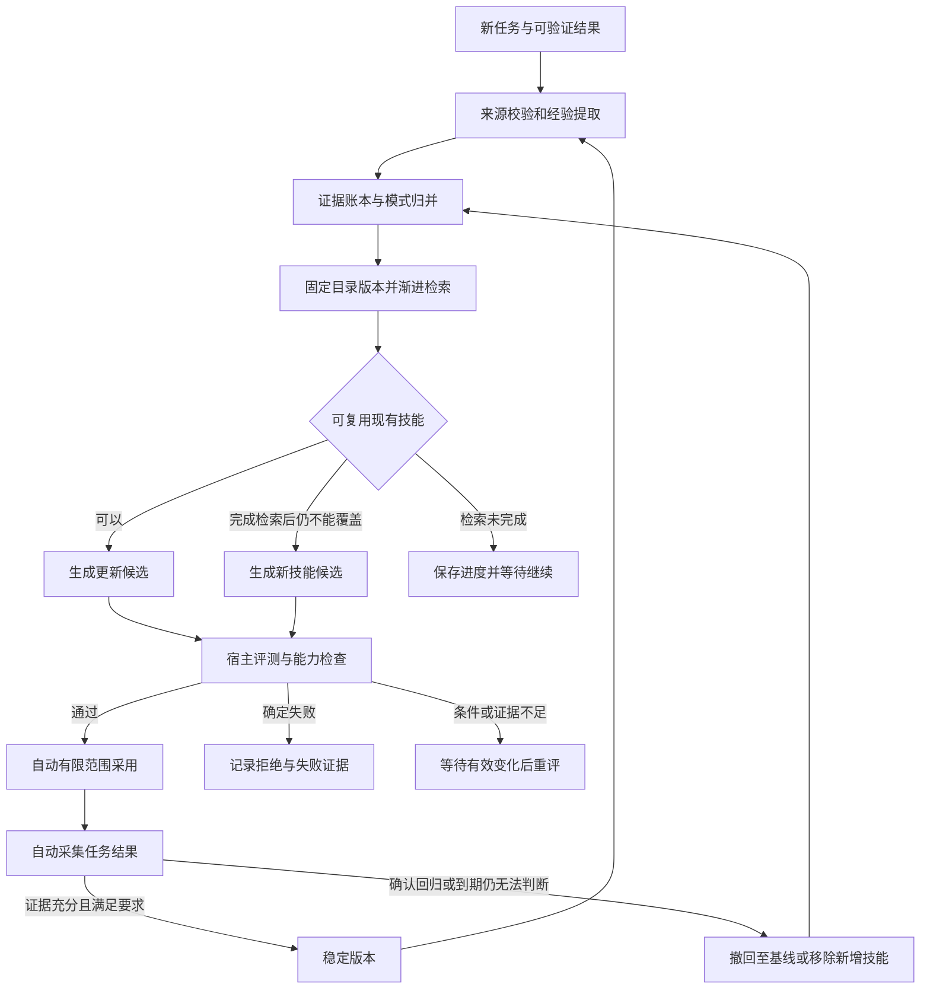

# 技能自进化最终方案与实施步骤

2026-11-20 更新：当前宿主对技能创建和更新只做安全审查，通过后自动发布。下文的行为评测、使用证据、观察期与人工确认属于历史设计。现行流程见[候选发布协议](../go-harness/internal/acp/skill-evolution.md)。

设计日期：2026-11-09。实施与桌面部署日期：2026-11-10。状态：S0–S8 代码实施、回归验证、实际配置迁移和本机桌面替换已完成；证据及验证范围见第 14 节。

技能自进化采用唯一的自动处理流程：从新任务提取有效经验，复用或生成技能，经宿主验证后自动采用，持续观察，并在发生回归或无法完成验证时自动撤回。客户无需配置技能进化开关、审核模式、专用模型或额度。

本方案取消技能自进化的 token 累计额度和每日模型调用次数上限；同时移除旧的每日提案、每日发布配额，使用并发控制、任务去重、有限重试和版本串行发布管理运行。token 与调用次数继续作为使用量统计和效果评测数据。

本方案替代此前技能进化设计中的预算配置、人工采用模式、历史阻断任务恢复和脚本人工发布兜底。已有技能、运行检查点、有效版本和审计记录继续保留。以下章节保留设计契约，第 14 节记录本次已实施范围与实测结果。

## 1 产品行为与范围

| 项目 | 最终行为 |
| --- | --- |
| 自动采用 | 始终运行。验证通过后自动采用，无人工审批步骤，无关闭自动采用的配置 |
| 客户配置 | 无技能自进化专用配置项，默认配置中删除整个 `skill_evolution` 配置块 |
| 模型选择 | 继承主模型；任务创建时固定实际模型、参数和工具环境身份 |
| token 额度 | 删除累计额度、额度预留、额度耗尽阻断、阶段额度分配和每日恢复逻辑 |
| 每日调用次数 | 删除全流水线及分阶段的每日调用上限 |
| 提案与发布配额 | 删除旧每日计数限制；同一技能一次只允许一个活动采用流程 |
| 使用量 | 保留实际调用次数、token、耗时和失败统计，明确区分实际值、估计值和未知值 |
| 新技能 | 与已有技能更新使用统一验证与自动采用流程 |
| 脚本技能 | 必须经过真实隔离执行；缺少执行能力时等待运行条件，不改走人工发布 |
| 历史数据 | 不重排、不补跑、不复活旧阻断任务和待人工审核提案 |
| 旧配置 | 一次性迁移后删除；正常运行时只接受新契约 |
| 管理操作 | 可以查看证据、纠正来源、撤回或删除具体技能；不提供人工批准候选的替代通道 |

自动采用的授权不扩大已有数据来源、工作区、工具和外部操作权限。系统从已授权来源提取经验，在所属工作区的受管技能空间中生成和更新技能，不能自动扩散到其他工作区或用户。

本次删除的是技能自进化的累计配额。模型自身的上下文容量、单次输出长度、单次执行超时及防止工具循环的执行步数约束继续承担技术边界；前台任务、子代理和供应商的独立策略不随本方案修改。技能进化任务不借用来源任务的累计 token 或模型调用额度。

## 2 总体流程

Go harness 负责调度、证据、验证、发布和回收。SQLite 保存状态、租约、调用记录和阶段进度；继续使用不可变技能对象、运行快照、发布 CAS 和文件发布日志，不引入第二套运行后端或新的消息中间件。

候选、评测和发布分别记录状态。评测失败不能变成发布成功；评测没有结论不能变成质量通过；已发布但处于观察中的版本不能显示为稳定版本。

## 3 零配置与一次性切换

### 3.1 新配置契约

配置文件无需保留空的 `skill_evolution` 块，也无需让客户填写 `schema_version`。以下标记保存在内部状态中：

| 内部标记 | 用途 |
| --- | --- |
| `schema_version` | 数据结构及状态协议版本 |
| `policy_version` | 验证、调度、观察和保留规则版本 |
| `pipeline_epoch` | 区分旧流水线与新流水线 |
| `input_watermark` | 确定新流水线接收任务与证据的起点 |
| `migration_id` | 配置文件与数据库迁移的恢复标识 |

旧 `enabled`、`mode`、阶段开关、专用模型、额度、人工审核与迁移确认字段均删除。旧的来源绑定信息如仍被已发布技能引用，应保存为技能来源元数据；来源权限继续由现有授权体系管理，不能因删除配置而放宽或丢失。

更新 Go 配置 schema、解码和投影、启动接线、SDK/管理协议、Rust 设置类型、桌面表单、示例配置、发行默认配置和相关指南，避免旧设置从客户端保存操作中重新写回。

### 3.2 迁移顺序

1. 在启动新流水线前获取维护锁，暂停旧生产者领取任务，写入迁移日志。旧 worker 的代际凭证失效，迟到结果不得发布。
2. 记录固定的 `migration_id`、新 `pipeline_epoch` 和持久任务起点。优先使用数据库任务序号及身份，不以单独的墙上时间判断新旧任务。
3. 一次性迁移器读取旧配置，保留无关配置和仍有效的授权信息，生成删除旧技能进化字段后的配置，执行新契约校验。
4. 使用临时文件和原子替换更新配置；文件与 SQLite 之间通过迁移日志恢复，不能假设二者存在共同事务。
5. 标记旧未完成的学习、生成、评测和人工审核工作为仅供历史查询，不在新调度器中领取。旧任务的后续重试、恢复、子任务和重发表述仍属于旧来源。
6. 重建现有技能、运行检查点和发布日志的必要引用保护；保留历史使用量、版本和审计记录。
7. 校验新配置、引用与起点一致后提交迁移完成标记，启动新流水线。重启沿用相同起点，不重新切水位。

迁移不执行任何历史模型任务。迁移失败时保留可恢复日志并报告具体失败，不能启动半迁移状态的自动发布。正常运行路径不保留旧配置兼容分支；历史数据的只读解释与旧配置兼容是独立职责。

### 3.3 现有发布与观察

现有稳定技能可以继续使用，并可作为新任务的基线。已有运行继续使用固定的历史版本。

迁移前仍在观察中的版本需要单独登记和保护：不以新规则直接认定通过，不重启旧学习链。继续保留其既有观察期限和回滚基线，由不产生历史补跑的收尾流程处理；期限已到仍无确定结论时，按 CAS 撤回。收尾的结果只用于版本状态与审计，不生成历史演进任务。

## 4 调度与调用记录

### 4.1 完整删除额度执行链

必须同时清理以下位置，不能只删除设置项或把额度改成一个大数：

| 位置 | 修改内容 |
| --- | --- |
| 配置与公开类型 | 删除 `MaxDailyTokens`、`MaxDailyModelCalls`、预算对象和对应 JSON/YAML 字段 |
| 阶段输入快照 | 新快照不携带额度，摘要改为绑定输入、来源、模型环境和策略版本 |
| 模型调用准入 | 删除每日累计量比较和额度预扣 SQL；保留租约、身份、授权、截止时间及输入完整性校验 |
| 学习阶段准入 | 删除学习预算与维护预算取最小值的二次限制 |
| 调度就绪判断 | 删除 40/30/30 等每日额度份额分配，改为按任务类别轮转和等待时长调度 |
| 重试 | 删除等待跨日、额度恢复和余额查询逻辑 |
| 错误及诊断 | 新任务不再产生内部 `budget_exhausted` 或 `review_budget_exhausted` |
| 桌面与管理接口 | 删除额度编辑、余额显示、额度耗尽提示和相关迁移确认 |

供应商限流或余额不足归类为外部服务不可用，保留真实原因并退避；不能伪装成已经删除的本地每日额度限制。

### 4.2 保留调用生命周期

将现有额度 Broker 改为调用生命周期记录器。每个请求在发送前持久化调用身份，完成后关联模型结果、使用量和失败原因；调用记录不包含任何可扣减余额。

调用身份绑定任务、阶段、输入摘要、模型身份和尝试序号。正常重启重用已持久化的结果。请求已发出但结果未保存时标记结果未知：供应商支持请求幂等键时复用该键，否则只允许受控重试并记录可能重复的请求，不能声称跨外部服务实现恰好一次调用。

缺少 token usage 不影响有效模型结果的验证，统计记为未知或明确的估计值。实际 token、估计 token 和调用次数分列保存，不能把旧的保守预扣值解释成实际消耗。调用记录存储失败属于持久化故障，应停止该任务的后续外部操作以保留恢复依据。

### 4.3 内部运行规则

- 使用有界 worker 和持久队列；前台交互优先，后台阶段采用轮转与等待时长补偿，避免生成或评测长期饿死。
- 同一工作区与证据摘要合并重复输入；同一技能仅一个活动采用流程，后继证据聚合后等待。
- 单个调用及阶段保留超时；瞬时故障最多执行三次总尝试，退避和已用次数持久化，重启不清零。
- 真实质量失败不按瞬时故障重试。相同候选、相同证据和相同验证环境不得循环重新生成或发布。
- 分页及评测批次有确定的工作量和游标。调度切片到期保存进度，下一片只推进未完成部分；失败重试不重置该片的固定截止时间。
- 暂时没有 worker、依赖或磁盘空间时保留可恢复状态，并由相应条件变化唤醒；不定时重复调用模型试探相同失败。
- 无每日调用、token、提案或发布计数闸门，也不通过隐藏默认值、环境变量或旧快照保留这些闸门。

并发、超时和重试属于版本化内部策略，不暴露为技能进化配置。可以分日展示统计，但日期切换不参与任务准入。

## 5 经验与模式

### 5.1 证据来源与独立性

由宿主根据实际执行关系建立任务边界。一个聊天里的不同独立任务可以产生独立证据；同一根任务的重试、子代理、恢复和总结不能增加独立样本数。模型可以提出分段建议，不能自行签发新的证据身份。

维护模型调用、合成样例和离线评测不计为真实独立任务证据，也不计入线上观察成功数。它们可以产生评测记录，但不能通过自行生成任务使候选达到推广或稳定化门槛。

经验记录绑定来源任务、工作区、授权代际、实际结果、技能版本和有效状态。采集来源包含宿主可验证的成功、明确纠正和可复现失败；执行结束或模型自述不能直接成为成功证据。撤回来源时，同时影响派生模式、待采用候选和相关发布判断。

一次性事实与临时环境信息进入适合的上下文存储；重复有效的方法才进入技能演进。至少两份独立任务证据用于支持自动推广，但不能替代行为验证，也不能把模型推断的相似性当作独立事实。

### 5.2 解除模式容量阻断

把完整证据账本与模型可见的代表样本分开。128 改为扫描或工作集大小，32 改为单次上下文样本上限；两者均不再限制生命周期内的模式或成员总数。

宿主从完整账本计算有效独立样本数，保存支持、反对、冲突和撤回信息的投影。即使某条证据没有抽入当前模型上下文，其冲突或撤回状态仍必须影响资格判断。

允许在新模式创建受资源压力影响时合并已有模式。已付出模型调用得到的判断先持久化，再执行容量相关提交；等待容量不丢弃结果，不退回重新调用模型。

归档只降低检索与存储热度，不表示删除、失效或取消曾经的忽略决定。长期存储采用压缩、归档及受引用保护的保留策略，不能改为无限复制完整成员列表。

## 6 技能发现与候选生成

### 6.1 渐进检索

检索固定一个当前授权目录版本，保存检索范围、目录身份、分页游标、已排除项、待确认项及各页结果。目录索引先使用名称、描述、作用域、实际使用和关键词；只有需要确认时才读取正文。

8 作为每批正文数量的初始上界，同时遵守单次上下文容量。现有 128 项目录截断也必须改为分页，不能只修复最外层的 8 项限制。

对全目录的覆盖可来自已审计的元数据规则排除和必要正文验证；top-k 未命中不能证明全局不存在。只有授权范围已经覆盖、没有未解决的可能匹配时，才进入新技能生成。

检索未完成时保存 `search_incomplete`，由资源或依赖恢复继续推进。已确认的复用与合并可以先完成。目录发生变化时重验受影响部分，发布前仍须核对当前目录、来源和目标版本。

### 6.2 候选生成

优先使用现有技能，再考虑更新、合并或创建。候选采用完整包身份，包含 `SKILL.md`、引用文件、脚本和依赖声明；文件变化均使之前的验证失效。

新技能写入宿主为当前授权工作区管理的来源，无需客户填写 `new_skill_source`。不得覆盖内置或只读来源；需要扩展其行为时，在许可的受管来源中形成独立候选，并验证名称和路由冲突。

匹配到其他工作区私有技能、内置技能或只读技能时，改进候选在当前工作区的受管来源独立创建，并固定原始版本作为来源证据。其他工作区同名私有技能使用确定性的工作区名称消歧；公共技能、当前工作区技能及删除标记的冲突仍必须处理。即使 SDK 单独授权内置来源用于人工生成，自动进化也不能改写内置来源。生成器可输出包含脚本和依赖的完整包，采用资格由宿主实际验证决定。

描述应简短并限定适用范围，正文只写可复用方法，资料按需引用。候选不能携带凭据、源聊天私密内容、临时路径、现场状态或提升权限的规则。

## 7 自动验证与采用标准

### 7.1 验证由宿主管理

宿主拥有评测集、断言、评分器和采用规则。候选只能读取执行任务所需输入，不能修改答案、评分器或通过条件。模型可以建议测试样例，样例进入发布闸门前必须有可核对的来源或经过校准的判定标准。

评测集区分改进样例、回归样例和未参与候选生成的验证样例。反复针对失败结果修改候选后，需要补充新的验证样例，避免把反复试过的数据继续当作独立验证。

优先检查产物和环境最终状态。模型评分使用独立上下文、固定维度和证据引用，允许输出未知。仅有候选自述、评分模型的无依据好评或测试结构合法，均不足以满足采用条件。

### 7.2 基线与测试覆盖

| 变更类型 | 基线 | 必须覆盖 |
| --- | --- | --- |
| 已有技能更新 | 当前有效版本 | 改进任务、历史回归、关键副作用 |
| 新技能 | 当前技能集合，不加入候选 | 真实任务收益、现有技能竞争和重复覆盖 |
| 描述或路由变化 | 当前目录中的选择行为 | 正向触发、负向触发、相邻技能误选 |
| 脚本或依赖变化 | 旧版本或无候选状态 | 真实隔离执行、输入输出、依赖、退出与资源清理 |
| 精简或效率改进 | 同环境下的旧版本 | 功能不退化、触发不变差、收益超过重复运行噪声 |

基线与候选使用相同模型和可比较的初始环境，运行于独立上下文和干净工作区。评测环境的工具能力应与生产使用范围相符。基线不可用时记录没有结论，不能把环境故障当作候选胜出。

采用必须满足：包与来源有效；核心断言全部通过；没有关键回归；触发满足正反例；观察到预先定义的功能、触发或效率收益；存在未被污染的验证证据。无实质收益的等价候选不发布。

关键行为默认重复验证，重复次数、最小收益及不同风险类别的覆盖要求由内部 `policy_version` 固定。在接通真实模型后用保留任务校准；阈值不能由候选修改，也不能用测试数量宣称统计显著性。

现有固定评测集只承担其覆盖范围内的回归检查。自动从新出现的可复现问题扩展样例；没有可信判定标准时进入 `blocked_evidence`，不能依赖客户为每个技能手工编写评测文件。

现有最多 32 个套件、单套件 16 个样例及关联结果数量的限制改为加载和执行批次边界。完整套件目录、必需覆盖清单和结果持久保存，按需分页；不能只评测被截断后的前一批就判定通过，也不能因为新增套件超过 32 个而无法配置整个评测器。

### 7.3 脚本执行

Go 宿主提供隔离执行接口，首个实现对接受管 OCI 沙箱，使用固定镜像、临时文件系统、受限网络、明确的超时和真实进程结果。发行及部署按支持平台提供或探测执行能力；本地 shell、PowerShell 或 WSL 不能仅因独立目录而被标为安全隔离。

测试数据和外部写操作使用隔离 fixture；不把生产凭据传给候选，不在真实业务系统重复执行有副作用的基线与候选。脚本解释器和依赖在受管评测环境中准备，不能通过加载技能隐式修改客户主机环境。

缺少沙箱、解释器或必需依赖时进入 `blocked_runtime`，依赖就绪后自动恢复。仅完成静态检查不能把 `IsolatedScripts` 标成真，也不能退回人工确认后自动发布。

### 7.4 验证身份

验证记录绑定候选摘要、基线摘要、目录身份、模型及参数、harness/工具契约、依赖环境、评测集和策略版本。任一相关身份变化都会使待发布结论失效，自动安排相关范围重评。

主模型变化后，新候选使用新的验证环境。已有稳定版本标记验证环境过期并按影响范围安排重评，不因模型升级同时删除全部技能，也不能继续把旧评测展示成新环境已验证。

## 8 发布与观察

### 8.1 原子采用与使用范围

采用前重新检查来源授权、候选摘要、验证身份、目标 head 和目录关系，并以 CAS 提交。数据库状态与技能文件通过既有持久发布日志完成一致性恢复。

每个目标保存当前稳定版本和观察中的候选。首次采用由宿主自动选择有限的新任务使用候选，其他任务继续使用稳定版本；同一任务固定版本，不中途切换。并发观察名额由宿主分配，无客户灰度参数。

新技能在观察范围外不加入普通技能目录；稳定后进入正常分发。因此，观察范围不能只靠文件目录是否存在来实现，技能可见性、选择目录与快照构建必须读取同一发布状态。

旧文件只读消费者如不能遵守观察范围，仅导出稳定版本。模型直接访问技能正文和执行 `skill_run` 也必须遵守同一个版本与作用域契约。

### 8.2 首版观察规则

观察时长固定为 72 小时，首版稳定化要求至少五个不同根任务的有效成功、覆盖变更涉及的关键行为，并且没有确认归因于候选的失败。该数量是运营门槛，不等价于统计显著性或长期质量保证；实施验收须以真实任务校准，调整通过内部策略版本发布。

| 事件或状态 | 动作 |
| --- | --- |
| 宿主已确认的关键回归 | 立即隔离候选并尝试 CAS 撤回 |
| 同版本两个独立根任务出现可归因失败 | 撤回；中间出现成功不清除累计失败 |
| 一个普通可归因失败 | 不得稳定化，安排隔离复核；确认回归则撤回 |
| 成功数及行为覆盖满足要求，且无确认失败 | 转为稳定版本 |
| 缺少结论、结果混合或工具设施故障 | 保持有限范围，不标记通过；不把未知记为成功 |
| 72 小时结束仍不满足稳定化要求 | 自动撤回；新增技能退出分发 |
| 目标已被更新为其他版本 | 标记 `superseded`，不覆盖更新后的 head |

生产证据以宿主可验证的结果为主，人工纠正可以补充，但不要求人工确认每个任务。一个根任务的重试和子代理最多计作一份有效观察。测试环境故障、权限不足、用户取消和供应商限流不是技能质量失败。

到期撤回后保留候选、证据和撤回原因。相同候选在相同证据与环境下不能再次发布；新增独立证据、有效修复或环境实质变化后，可以创建明确关联的后继候选。用户主动撤回或删除的意图必须进入去重与排除判断，避免马上重新生成相同技能。

稳定化以后仍记录版本使用与回归证据。后续确认回归时先隔离当前版本，再选择仍适用于当前环境的已验证基线；没有合格基线时退出该技能的自动分发。不能回滚到已失效环境中的旧版本，也不能修改正在执行任务固定的版本。

### 8.3 状态与恢复

| 对象 | 状态语义 |
| --- | --- |
| 候选 | `generated`、`evaluating`、`eligible`、`rejected`、`superseded` |
| 等待 | `search_incomplete`、`blocked_evidence`、`blocked_runtime`、`deferred_capacity`、`waiting_provider` |
| 发布 | `observing`、`stable`、`rolled_back`、`withdrawn`、`superseded` |
| 单次测量 | `success`、`failure`、`inconclusive`、`measurement_error` |

数据库可复用已有状态加原因字段，不要求为每个展示词建立新表。状态转换必须写入原因、关联版本和策略身份；无人工待批准状态，无本地额度等待状态。

## 9 版本保留与回收

32 个版本改为维护目标，不再按累计候选数量拒绝后续更新。注册表的 128 个技能数量上限也改为索引和工作集边界，允许在资源可用时注册第 129 个技能；不能只解除检索截断而保留创建阻断。

总存储字节、单文件大小和内存工作集仍是资源边界。容量不足时先进行维护，无法释放则保存 `deferred_capacity` 并等待资源变化，不以无限保留代替容量治理，也不把阶段性容量压力解释为永久停止学习。

先建立统一的持久引用保护，覆盖稳定 head、观察候选、回滚基线、运行快照、可恢复检查点、待处理提案、评测、发布日志和文件导出。运行快照新增租约与释放机制；`Subset`、恢复及工作区切换继承正确引用，不能仅保护最外层快照。

第一阶段只回收已终结、未发布且无引用的候选内容；发布历史暂不积极清理。完成所有读写入口的保护并验证恢复行为后，再对发布历史启用保留策略。

回收采用标记、重新检查、删除和进度记录。在版本或对象进入删除阶段后，新引用获取必须与删除互斥；宽限期不能代替并发保护。内容寻址对象需检查全部版本引用，不能因为某个版本被删就删除共享对象。

审计元数据与可恢复内容分开保留。内容确已回收的历史项显示内容已过期，不提供失效的恢复操作。活动任务、检查点和回滚基线所需内容不可过期。先进行回收演算，再开放真实删除。

## 10 可观察性与桌面体验

技能页面展示当前技能、观察中的变更、最近自动采用与撤回、验证结果和等待原因。支持查看原始证据的授权范围内摘要、版本差异、模型环境和实际执行结果。

使用量视图展示模型调用次数、实际及未知 token、耗时、排队时长、阶段失败原因和采用收益；不再展示每日剩余额度或预算配置。

桌面删除审核模式、自动采用开关、单独模型、各阶段预算和迁移确认控件。保留对具体技能的撤回、纠正和删除。自动生成的候选不能借用人工导入、直接编辑或旧发布接口绕过验证；用户显式编辑技能仍遵守既有文件权威约定，其 head 变化使旧自动采用流程的 CAS 失效。

旧 ACP/MANAGE、SDK 和桌面请求中的额度或采用模式字段显式报废弃错误，不能静默接受。客户端与后端随同一版本更新，不维护旧配置兼容行为。

更新内置 `skill-creator`、技能运行指南和相关提示词，移除等待人工采用、额度耗尽后隔日再试和未运行脚本可人工放行的指引。

桌面计算与查询在后台完成，渲染只读取缓存状态；不在逐帧路径读取数据库、遍历文件或启动外部进程。

## 11 实施步骤

各阶段按以下顺序完成。修改仅落在实施分支；所有必需阶段通过后再发布新自动采用版本，不向客户交付依赖隐藏开关切换的半套流程。

| 阶段 | 工作内容 | 主要代码位置 | 完成条件 |
| --- | --- | --- | --- |
| S0 契约与迁移准备 | 固定新状态、内部策略、新快照格式、代际及迁移日志；建立调用和版本引用边界 | [维护任务类型](D:/Tools/deerflow-api/go-harness/internal/skillmaintenance/types.go)、[维护迁移](D:/Tools/deerflow-api/go-harness/internal/skillmaintenance/migration.go)、[学习存储](D:/Tools/deerflow-api/go-harness/internal/learning/store.go) | 重启幂等、旧 worker 被隔离、新旧来源界限可测试 |
| S1 删除配置和额度 | 删除全部进化配置与每日准入条件，将调用预留改为持久调用记录，去除基于额度份额的调度 | [配置 schema](D:/Tools/deerflow-api/go-harness/internal/configschema/evolution.go)、[配置解码](D:/Tools/deerflow-api/go-harness/internal/skills/evolution/config.go)、[调用记录](D:/Tools/deerflow-api/go-harness/internal/skillmaintenance/calls.go)、[阶段就绪](D:/Tools/deerflow-api/go-harness/internal/learning/queue_readiness.go)、[模型适配](D:/Tools/deerflow-api/go-harness/internal/engine/eino/skill_maintenance.go)、[公开类型](D:/Tools/deerflow-api/go-harness/harness/skill_generation.go) | 超过原额度仍继续推进；usage 缺失不阻断；没有隐藏日配额 |
| S2 证据与模式 | 宿主任务边界、完整成员账本、独立计数、冲突和撤回投影、模式分页及持久化决策 | [运行时学习](D:/Tools/deerflow-api/go-harness/internal/runtime/skill_learning.go)、[模式](D:/Tools/deerflow-api/go-harness/internal/learning/patterns.go)、[归并队列](D:/Tools/deerflow-api/go-harness/internal/learning/consolidation_queue.go)、[归并提交](D:/Tools/deerflow-api/go-harness/internal/learning/consolidation.go) | 第 129 个模式及第 33 个成员不阻断；同源重复不增票 |
| S3 检索与生成 | 目录分页、覆盖记录、正文按需加载、结果复用、受管来源创建、统一新技能候选流程 | [匹配队列](D:/Tools/deerflow-api/go-harness/internal/learning/matching_queue.go)、[匹配判定](D:/Tools/deerflow-api/go-harness/internal/learning/matching.go)、[目录](D:/Tools/deerflow-api/go-harness/internal/skills/matching.go)、[模型匹配](D:/Tools/deerflow-api/go-harness/internal/engine/eino/skill_matching.go)、[经验发现](D:/Tools/deerflow-api/go-harness/internal/skills/evolution/discovery_experience.go) | 第 9 个正文及第 129 个目录项可继续检索；未完成不创建重复技能 |
| S4 验证与沙箱 | 自动评测样例准入、套件分页、干净环境对照、正反触发、真实脚本 runner、验证身份和模型变化重评 | [评测契约](D:/Tools/deerflow-api/go-harness/internal/skillbehavior/suite.go)、[套件注册](D:/Tools/deerflow-api/go-harness/internal/skills/evolution/behavior_store.go)、[行为评测](D:/Tools/deerflow-api/go-harness/internal/skills/evolution/behavior_evaluation.go)、[模型行为执行](D:/Tools/deerflow-api/go-harness/internal/engine/eino/skill_behavior.go) | 新技能与脚本候选有实际自动验证路径；套件增加不导致停摆；核心结果未知时不发布 |
| S5 引用保护与存储 | 覆盖快照、恢复、观察和发布操作的持久引用；先演算后清理终态候选，解除版本与技能数量硬上限 | [注册表](D:/Tools/deerflow-api/go-harness/internal/skills/registry.go)、[快照](D:/Tools/deerflow-api/go-harness/internal/skills/snapshot.go)、[版本发布](D:/Tools/deerflow-api/go-harness/internal/skills/publications.go)、[对象存储](D:/Tools/deerflow-api/go-harness/internal/skills/objects.go)、[运行状态](D:/Tools/deerflow-api/go-harness/extensions.go) | 第 33 个版本和第 129 个技能仍可演进；运行和恢复所需对象不被删除 |
| S6 自动发布与观察 | CAS、稳定及观察版本路由、宿主质量证据、到期撤回、重复发布抑制和长期回归处理 | [采用准入](D:/Tools/deerflow-api/go-harness/internal/skills/evolution/auto_patch_store.go)、[观察器](D:/Tools/deerflow-api/go-harness/internal/skills/evolution/auto_patch_monitor.go)、[观察 worker](D:/Tools/deerflow-api/go-harness/internal/skills/evolution/auto_patch_worker.go)、[文件发布](D:/Tools/deerflow-api/go-harness/internal/skills/file_publications.go) | 无人工门槛；失败成功失败不能通过；超时撤回；并发人工修改不被覆盖 |
| S7 协议桌面与指南 | 删除旧编辑项、接口和指引；接通状态、证据、用量统计及具体技能管理；同步全部默认配置 | [设置文档](D:/Tools/deerflow-api/go-harness/internal/desktopconfig/document.go)、[配置保存](D:/Tools/deerflow-api/go-harness/internal/desktopconfig/save.go)、[Rust 配置](D:/Tools/deerflow-api/desktop-app/crates/waku-core/src/deerflow_config.rs)、[进化界面](D:/Tools/deerflow-api/desktop-app/src/app/deerflow_settings/evolution.rs)、[学习界面](D:/Tools/deerflow-api/desktop-app/src/app/deerflow_settings/learning.rs)、[采用界面](D:/Tools/deerflow-api/desktop-app/src/app/deerflow_settings/auto_patch.rs) | 客户零新增配置；界面和协议没有旧模式；运行状态可解释 |
| S8 集成与发行验收 | 全新环境、一次性迁移、真实模型与沙箱、长时间积累、重启及并发故障注入；执行统一切换 | [运行时测试](D:/Tools/deerflow-api/go-harness/internal/runtime)、[维护测试](D:/Tools/deerflow-api/go-harness/internal/skillmaintenance)、[技能测试](D:/Tools/deerflow-api/go-harness/internal/skills)、[CI](D:/Tools/deerflow-api/.github/workflows/go-harness.yml) | 全部必需验收项通过；已有稳定技能和新自动采用均可用 |

S4 完成以前不得取消真实验证闸门；S5 完成以前不得启用扩大范围的历史内容回收；S6 完成以前不得把生成成功显示为采用完成。S1、S7 对公开契约的变更随同一发行版本交付。

需要同步的默认配置为 [通用默认配置](D:/Tools/deerflow-api/resources/default-config.yaml)、[桌面默认配置](D:/Tools/deerflow-api/resources/desktop-default-config.yaml)、[桌面发行配置](D:/Tools/deerflow-api/desktop-app/resources/deerflow/default-config.yaml) 和 [示例配置](D:/Tools/deerflow-api/config.example.yaml)。实施时保留这些文件中与本方案无关的已有修改。

## 12 必需验收

| 类别 | 场景 | 预期 |
| --- | --- | --- |
| 零配置 | 全新配置没有 `skill_evolution` | 使用主模型自动运行，无默认关闭分支 |
| 额度删除 | 调用和 token 均超过旧上限，跨日继续运行 | 继续处理，统计正确，无余额与跨日重启准入 |
| 无 usage | 供应商不给 token 计数但返回有效结果 | 结果可以验证，统计标记未知 |
| 记录恢复 | 请求发送前后及保存结果时崩溃 | 已保存结果复用，未知调用明确记录，无无限重试 |
| 旧配置 | 含不同阶段模型、额度、开关及人工模式 | 一次迁移后字段消失，无迁移确认步骤，无运行时双配置 |
| 历史边界 | 旧阻断、旧 pending、旧根任务重试及其子任务 | 均不补跑；新根任务正常进入 |
| 迁移中断 | 数据库和配置文件更新之间崩溃 | 按同一迁移日志恢复，水位与发布只生效一次 |
| 目录容量 | 9 个正文候选、129 个技能目录项 | 分页推进，缺少覆盖不能判定全局不存在 |
| 目录变化 | 分页中删除、更新或撤回来源 | 相关结果失效，旧授权不能用于发布 |
| 模式容量 | 129 个模式、单模式 33 条及更多成员 | 合并与创建继续；冲突和独立计数仍正确 |
| 任务独立性 | 同聊天两项独立任务，以及同根任务多次重试 | 前者可积累独立证据，后者不增票 |
| 反馈污染 | 多次维护调用、合成样例和离线评测成功 | 不增加真实任务票数和线上观察成功数 |
| 公平调度 | 抽取大量积压，同时有待评测与待采用任务 | 后续阶段获得执行机会，前台交互不被阻塞 |
| 新技能 | 无已有目标但有充分证据与验证收益 | 自动建立受管候选、评测并采用，无人工待审 |
| 评分污染 | 候选修改评分文件、伪造成功或只适配生成样例 | 不获得采用资格，验证证据可追溯 |
| 评测容量 | 第 33 个套件、超过单批 16 个样例及其结果 | 分批加载和执行，必需样例未完成时不发布 |
| 脚本 | 静态正确但执行失败，或没有隔离执行环境 | 前者验证失败，后者明确等待条件，均不发布 |
| 触发 | 新描述抢占相邻技能或不该触发时触发 | 不通过路由验证 |
| 观察质量 | 失败、成功、失败 | 不能稳定化，按失败规则撤回 |
| 观察不足 | 72 小时无足够有效结果或仍有未解决失败 | 自动撤回，不标为通过 |
| 无人工反馈 | 宿主可验证的独立任务满足观察条件 | 自动稳定化，无需 operator confirmed |
| 版本路由 | 观察任务、普通任务与已运行任务同时存在 | 分别使用固定的正确版本，普通目录不泄露观察候选 |
| 发布竞争 | 观察期间用户直接修改目标 head | 旧流程变为 superseded，撤回不覆盖新 head |
| 循环抑制 | 撤回后重启或重复同一输入 | 相同候选不立即重新发布 |
| 模型变化 | 验证后切换主模型或工具契约 | 待发布结论失效，按新环境重评 |
| 版本容量 | 同一技能超过 32 个候选或版本 | 维护继续；需要的历史仍可读取 |
| 注册容量 | 受管注册表新增第 129 个技能 | 资源可用时创建成功，不再被固定技能数量拒绝 |
| GC 竞争 | 活动快照、Subset、恢复检查点、共享对象与回收并发 | 不删除有效引用；新引用与删除正确互斥 |
| UI 和指南 | 设置保存、模型读取内置技能指南、状态查询 | 不恢复旧字段，不出现预算等待或人工采用指引 |

测试按阶段执行相关 Go 包测试、配置往返、协议及 Rust 设置测试；完成 S8 时执行项目要求的集成与构建检查。真实模型对照与脚本隔离验收需要单独记录任务、基线、环境、结果和失败解释，不能用 mock 通过替代。桌面验收核对实际进程、管理协议、数据库和配置；按仓库约定，本次未开展视觉测试。

## 13 对标依据

OpenAI 的技能评测方法强调实际轨迹、产物、明确成功条件及正负触发样例；本方案据此采用宿主检查和可持续扩展的评测集。[Testing Agent Skills Systematically with Evals](https://developers.openai.com/blog/eval-skills)

Claude Code 的技能评测包含干净会话、有无技能对照、断言证据、时间和 token 统计、版本盲测；本方案据此区分新技能与版本更新的基线，并把使用量保留为质量分析数据。[Evaluate and iterate on a skill](https://code.claude.com/docs/en/skills#evaluate-and-iterate-on-a-skill)

Anthropic 的 Agent 评测实践强调真实环境结果、隔离试验、确定性判定、未知结论和长期维护评测集；本方案据此将测量异常、证据不足和真实质量失败分开。[Demystifying evals for AI agents](https://www.anthropic.com/research/demystifying-evals-for-ai-agents)

OpenAI 的技能加载与设计建议强调简洁描述、明确适用范围和按需加载；本方案据此控制技能膨胀及上下文成本。[Build skills](https://learn.chatgpt.com/docs/build-skills)、[Rethinking skills and prompts for GPT-6 Astra](https://developers.openai.com/blog/rethinking-skills-and-prompts-for-gpt-6-astra)

始终自动采用、零专用配置、取消累计配额、72 小时观察和五个独立成功样本属于本项目的产品与工程决策；官方资料不为这些具体取值或整套自动发布实现背书。

## 14 实施与桌面部署记录（2026-11-10）

实施分支：`codex/skill-evolution-auto-20261109`。保留工作区原有修改；本次构建为本地 Release 开发版本，`BUILD_SOURCE.json` 明确记录 `development-dirty`，不冒充干净提交对应的分发安装包。

### 14.1 阶段完成情况

| 阶段 | 已完成实现及核验 |
| --- | --- |
| S0 | 一次性配置日志与数据库 epoch、水位、迟到结果隔离、历史输入及提案冻结；配置和数据库身份一致后启动 worker |
| S1 | 删除专用配置、token 累计额度、每日调用及提案/发布配额；保留有界并发、有限重试、公平调度和实际/估计/未知用量；百万次调用及大额 token 之后仍可完成流水线 |
| S2 | 宿主根任务独立性、完整证据账本及分页；支持第 129 个模式、第 33 个及更多成员；同根恢复和显式关联副本不增票，文本相同的独立根任务不合并票数 |
| S3 | 固定目录身份、渐进覆盖、保存已付费结果、自动工作区目的地及完整技能包；跨工作区、只读和内置来源形成独立受管候选 |
| S4 | 宿主产物/输出断言、生成后的独立验证证据、基线对照、正反触发、套件/样例/结果分页；实际 OCI 执行与环境身份变化重评 |
| S5 | 持久版本引用、快照/检查点/观察/回滚保护、保守候选 GC；撤回清理同时删除派生决策与生成缓存，保留检查点引用的内容 |
| S6 | 自动采用、CAS、工作区范围内的观察路由、独立任务质量计数、失败及到期回滚；历史观察期限保留，不触发旧模型任务补跑 |
| S7 | Go/Rust 协议及桌面旧配置控件删除，状态与等待原因展示；同步四份默认/示例配置和内置技能指南 |
| S8 | Go 当前测试清单核对、Rust 设置/Bridge、Windows 打包、真实模型与 OCI、核心与关键运行时竞态检测；完成实际备份、替换、迁移、启动及后端重启水位验证 |

### 14.2 测试证据和范围

| 检查 | 实测结果 | 证据 |
| --- | --- | --- |
| Go 当前全量清单 | 57 个包、1,738 项顶层测试：1,708 通过、30 条件跳过；没有缺失结果或未解决的失败 | [最终覆盖清单](D:/Tools/deerflow-api/.build-cache/skill-evolution-20261109/final-coverage.json) |
| 核心竞态 | learning、skills、skills/evolution 通过 | [Linux race 日志](D:/Tools/deerflow-api/.build-cache/skill-evolution-20261109/race-final-current.log) |
| 关键运行时竞态 | 任务继续执行、永久来源变化、结果复用、撤回/检查点保护、工作区/内置来源候选通过 | [运行时 race 日志](D:/Tools/deerflow-api/.build-cache/skill-evolution-20261109/race-runtime-final-current.log) |
| Rust 设置 | 216 通过 | [设置回归](D:/Tools/deerflow-api/.build-cache/skill-evolution-20261109/rust-settings-final.log) |
| Rust Bridge | 21 通过；发行二进制另通过管理、stdio、会话及恢复相关集成检查 | [Rust 回归](D:/Tools/deerflow-api/.build-cache/skill-evolution-20261109/bridge-tests-final.log)、[发行 Bridge 检查](D:/Tools/deerflow-api/.build-cache/skill-evolution-20261109/bridge-deployed-startup.jsonl) |
| Windows 打包 | 30 项源输入、失败路径、归档、校验和、环境检查通过；Release 构建成功 | [打包回归](D:/Tools/deerflow-api/.build-cache/skill-evolution-20261109/windows-package-final.log)、[构建日志](D:/Tools/deerflow-api/.build-cache/skill-evolution-20261109/desktop-release-deployed.log) |
| Go 模块/运行器/Eino 补丁 | 模块校验通过；运行器 388 项自检通过；检查点补丁测试通过 | [模块校验](D:/Tools/deerflow-api/.build-cache/skill-evolution-20261109/go-mod-final.log)、[运行器自检](D:/Tools/deerflow-api/.build-cache/skill-evolution-20261109/go-runner-check.log)、[Eino 检查](D:/Tools/deerflow-api/.build-cache/skill-evolution-20261109/eino-checkpoint-final.log) |
| 真实主模型与隔离执行 | `gpt-6.1-terra` 实际调用 4 次，基线产物不满足断言，候选产物满足断言；两次实际 OCI 执行，调用及产物证据可追溯 | [真实验收报告](D:/Tools/deerflow-api/.build-cache/skill-evolution-20261109/live-primary-oci-final.json)、[OCI 验收](D:/Tools/deerflow-api/.build-cache/skill-evolution-20261109/oci-final.log) |

清单保留各批原始结果与修复后重跑证据，通过当前测试枚举和原有 `Assert-GoTestCoverage` 核对。旧额度断言、旧文本去重假设及将已阻断输入当成可运行作业的测试夹具已修正；失败日志没有被改写成成功。30 项条件跳过包含平台链接能力、Python/WSL/Docker/外部工具等可选集成；其中真实主模型与 OCI 验收另有独立通过记录。未宣称完成所有平台的 CI 矩阵或 UI 视觉测试。

72 小时观察、到期撤回和长期容量边界通过受控时钟及积累数据测试。真实模型验收是隔离的受控案例，不代表已经完成 72 小时生产观察或证明所有技能的长期收益。

### 14.3 实际部署与配置

- 发行输出：[Release 程序包](D:/Tools/deerflow-api/dist/desktop/DeerFlow-Desktop-Go-20261110-SkillEvolution-Deployed)。后端构建号：`deerflow-skills-20261110-033034-718`。
- 原位置替换并启动：[当前桌面程序](D:/Tools/deerflow-api/dist/desktop/DeerFlow-Desktop-Go-20261010-103944/deerflow-desktop.exe)。9 个 EXE 与资源已替换，99 个发行文件校验一致，保留原快捷方式路径和 user-data。
- 完整备份：[旧程序、用户数据、旧配置及校验清单](D:/Tools/deerflow-api/.build-cache/skill-evolution-20261109/installed-backup-20261110-final)。备份目录限制为当前用户、管理员和 SYSTEM 访问。
- 配置已迁移：[仓库配置](D:/Tools/deerflow-api/config.yaml)、[实际桌面配置](D:/Tools/deerflow-api/dist/desktop/DeerFlow-Desktop-Go-20261010-103944/user-data/config/config.yaml)。删除 `skill_evolution`、`skill_evolution_migration_ack`、`skill_evolution_migration`；不新增客户技能进化配置。
- 两份配置其他 YAML 值保持一致。桌面配置通过完整 native schema 校验；仓库配置保留原有 Python/API 工具定义，仅迁移本次技能进化契约。仓库迁移日志停留在正常的 `config_written`，待该配置下次启动宿主时绑定数据库；实际桌面迁移日志已为 `complete`。
- 已安装 `skill-creator` 的四个指南文件升级前均与旧发行副本一致，已核对后更新。停机期间除配置、内部迁移日志及这四个指南外，其他 profile 文件校验一致。
- 当前主模型仍为 `gpt-6.1-terra`，学习模式 `automatic`，学习、生成、自动采用均启用，相关 worker 正常运行。现有目录尚未具备完整可信验证套件，状态如实显示等待验证证据；新任务按新流水线积累，不人为批准历史候选。

### 14.4 数据与重启验收

| 项目 | 升级前 | 升级后及后端重启后 |
| --- | --- | --- |
| 已安装技能 | 23 | 23，原记录全部保留 |
| 技能版本 | 39 | 40，原 39 条不可变记录均保留；新增一条 `skill-creator` 指南版本 |
| 发布历史 / 提案 | 2 / 1 | 2 / 1，均保留 |
| 会话 / 已执行 run | 58 / 5 | 60 / 5；原会话保留，桌面启动新增两个空会话，无新增执行 |
| 检查点 | 0 | 0；有引用的检查点内容保护另有回归覆盖 |
| 维护调用 / 维护任务 | 25 / 24 | 25 / 24，无旧模型任务补跑，无旧任务尝试次数增加 |
| SQLite 完整性 | quick_check=ok；0 外键违规 | quick_check=ok；0 外键违规 |
| 新流水线 | 尚未迁移 | `skill-evolution-v2`；epoch=`SKO7MCSN6ZSCXUWFJTVX7Z2EHA`；水位=`342324`；后端重启前后相同 |

数据校验证据：[升级前](D:/Tools/deerflow-api/.build-cache/skill-evolution-20261109/live-before-deployment.json)、[升级后](D:/Tools/deerflow-api/.build-cache/skill-evolution-20261109/live-after-deployment.json)、[重启后](D:/Tools/deerflow-api/.build-cache/skill-evolution-20261109/live-after-restart.json)。运行核验证据：[自动进化状态](D:/Tools/deerflow-api/.build-cache/skill-evolution-20261109/deployed-evolution-status.json)、[后端重启记录](D:/Tools/deerflow-api/.build-cache/skill-evolution-20261109/backend-restart-verification.json)、[配置与指南迁移](D:/Tools/deerflow-api/.build-cache/skill-evolution-20261109/installed-backup-20261110-final/migration-effects.json)。
